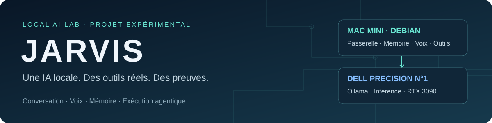

## Mission25 — capacités reçues avec réserves,21 octobre2026

Quatre compétences exécutables actives, création/réutilisation par JARVIS et MCP réel ;14A reste ouverte sur les limites mesurées. [Réception25](docs/missions/25/RAPPORT-FINAL.md) · [Bilan14A](docs/missions/25/BILAN-14A.md) · [PR18](https://github.com/regisazzoun/JARVIS-Local-AI-Lab/pull/18).

## Mission23D — réception numérique du20 octobre2026

✅🟡 **GO numérique avec réserves acoustiques, STT et d’autonomie.** Banc LiveKit et page temporaire réellement exécutés par JARVIS avec outils/corrections Codex. Six exécutions initiales conservées ; après correction du warmup AEC, trois interruptions mesurées à0,727 /0,559 /0,717s (seuil≤1s). Stop actif navigateur0,6ms, exports JSON/audio et contrôle d’annulation reçus. Le microphone/écho physique reste non testé ; une erreur de transcription du jour initial est documentée. [Réception finale23D](docs/missions/23D/RAPPORT-FINAL.md) · [Utilisation](docs/missions/23D/UTILISATION.md).

23D complète la même mission23, sans reset des douze validations ni création de mission moteur. Le NO-GO historique reste inchangé dans ses rapports ; son critère d’interruption numérique est désormais reçu par23D. Le périmètre global23, la route média distante et l’acoustique ne sont pas réceptionnés par procuration. Acquis du broker24 conservés. Publication sur `codex/mission-23d-interruption-livekit`, aucune fusion main. Les comptages historiques ci-dessous restent leurs instantanés datés.

# 🤖 JARVIS — Local AI Lab

### Construire une IA locale capable de converser, mémoriser et agir

Bienvenue dans **JARVIS**, un laboratoire privé qui explore une question concrète : comment faire coopérer des modèles d’IA, une mémoire persistante et des outils d’administration sur nos propres machines ?

Le projet avance sur du matériel réel, avec des essais, des corrections et des résultats documentés. **Codex coordonne et vérifie ; JARVIS exécute des tâches avec ses outils**, dans le périmètre autorisé. Les réussites comme les erreurs servent à construire la suite.

> **Notre démarche :** expérimenter sur le terrain, comprendre les échecs et conserver les preuves de ce qui fonctionne.

**[📋 Suivi des missions](SUIVI.md)** · **[🧭 Feuille de route](ROADMAP.md)** · **[📚 Rapports et preuves](docs/missions/README.md)** · **[🚀 Launcher V2](https://regisazzoun.github.io/JARVIS-Launcher2/)**

## 🎯 Ce que nous construisons

### 💬 Converser avec plusieurs modèles

Ollama et les modèles **Qwen, Ministral/Mistral et Llama** constituent le socle d’inférence. La passerelle JARVIS et Open WebUI donnent accès à la conversation ; leurs rôles et leurs historiques restent distingués dans l’architecture.

### 🎙️ Parler et retrouver le contexte

**Whisper Small** prend en charge la transcription et **Piper, voix Tom**, la synthèse. La mémoire **SQLite/FTS5** reste centralisée sur le Mac mini et réutilisée par la passerelle, y compris lorsque l’inférence est effectuée sur le Dell. Les tests sur fichiers audio sont documentés ; les réserves de microphone et de clients physiques restent explicites.

### 🛠️ Faire travailler l’IA avec de vrais outils

Les outils existants permettent des opérations de fichiers, de terminal, de Git et d’administration **SSH/Ansible**, contrôlées par la politique du laboratoire. JARVIS a déjà produit des fichiers, exécuté des opérations et repris des tâches réelles. La fiabilité de la planification et des fins de tâche reste un chantier : ces résultats ciblés ne valent pas réception d’une autonomie générale.

### 🖥️ Piloter le laboratoire depuis une interface

**[Launcher V2](https://regisazzoun.github.io/JARVIS-Launcher2/)** rassemble conversation, accès rapides, mesures des machines et événements d’exécution. Le **[Launcher V1](https://regisazzoun.github.io/JARVIS-Launcher/)** est conservé. Le frontend est accessible sur GitHub Pages ; les fonctions privées utilisent l’espace connecté et les mécanismes de tunnel/compagnon existants.

## 🧩 Deux machines complémentaires, une architecture commune

| Machine | Rôle documenté | État et limites |
| --- | --- | --- |
| **Mac mini Debian** | Passerelle JARVIS, mémoire canonique, Whisper/Piper, outils et supervision ; terrain initial des essais eGPU | Socle existant préservé ; la mémoire n’est pas une base répliquée sur chaque nœud |
| **Dell Precision n°1** | Inférence Ollama, modèles et accélération NVIDIA/CUDA | Réception **13D-E** conservée ; Tailscale enrôlé ; tunnels SSH/VNC LAN et tailnet direct reçus le19/10 ; une RTX3090 alimentée |
| **Dell Precision n°2** | Extension future du laboratoire | **Mission 14 à réaliser par JARVIS lui-même**, distincte du premier Dell installé par Codex |

L’intégration distante existe. En mission22, le routage interactif sur Mac, les missions sur Dell et un repli Ollama ont été testés. Le placement dynamique et l’équilibrage global restent à compléter pour progresser vers une seule entité JARVIS distribuée.

## 📍 Où en est le projet ?

**Dernier bilan :19 octobre2026 — mission21 reçue7/7 et moteur22 GO AVEC RÉSERVES.** Les états ci-dessous décrivent les preuves disponibles, pas une surveillance en direct.

| Chantier | Résultat établi | Suite |
| --- | --- | --- |
| **22 — Moteur agentique V2** | **GO avec réserves** :41 tests V2,25 contrôles navigateur ; reprise et publications vérifiées | [Bilan et preuves](docs/missions/22/RAPPORT-FINAL.md) ; autonomie longue encore partielle |
| **21 — Autonomie opérationnelle** | **7/7 tâches reçues**, accès VNC direct Tailscale testé par JARVIS | Rapports publiés ; interventions Codex et réserves sémantiques conservées |
| **13D-E — Dell n°1** | Debian, RAID1, deux ESP, SSH/sudo, Ansible, NVIDIA/CUDA, Ollama, modèles et intégration reçus | Loupé : Tailscale absent au déploiement, installé par JARVIS, enrôlé et accès direct reçu19/10 ; correctif reboot du contrôleur toujours distinct |
| **11-Agentic / 11B** | Outils hôte et administration SSH/Ansible permanente validés | Compute Expansion reste partielle ; checkpoint incomplet à reprendre dans son périmètre |
| **JL-01 / JL-02** | V1 conservée ; V2 livrée **GO avec réserves**, avec actions agentiques réelles | Fiabiliser l’agent et compléter les réceptions des clients physiques |
| **00 — Pilotage** | **68 missions/sous-missions**, **28 anomalies** et **129 documents/preuves** récupérés ; cinq tâches JARVIS exécutées | Conserver la traçabilité et la concordance README/SUIVI ; analyses guidées et corrections Codex explicites |
| **14A — Capacité agentique** | Progrès démontrés sur des scénarios ciblés | Réception globale ouverte |
| **14 — Dell n°2** | Périmètre défini, installation future par JARVIS | Préparer le déploiement selon ses critères ; aucune installation du second Dell dans l’audit 00 |
| **15A / 15B — Clients natifs** | Cahiers macOS/iOS et cinq incréments chacun définis | Non lancés ; mission 14 non bloquante ; installation iOS gratuite Xcode / Personal Team retenue |

**À retenir :** le titre historique « 13D-E / 14 » de la réception du premier Dell ne clôture pas la mission 14 du deuxième Dell.

## 📊 Toutes les missions, avec le même comptage que SUIVI

Le registre et le suivi comptent **74 identifiants**, dont **10 incréments natifs prévus, non exécutés**. Les regroupements et activités transversales ne créent pas de missions supplémentaires. Le catalogue ci-dessous reprend exactement les intitulés et états du tableau courant de SUIVI.

<strong>📋 Consulter les 74 missions et sous-missions</strong>

<!-- BEGIN MISSION CATALOGUE -->
## Catalogue des missions — 74 identifiants

**74 missions et sous-missions recensées**, dont dix incréments 15A/15B prévus, non exécutés. Cette liste reprend exactement les identifiants, intitulés et états du tableau courant de [SUIVI.md](SUIVI.md). Les lignes « 09 à 11 » (regroupement historique) et « Documentation » (activité transversale) ne sont pas des missions supplémentaires et ne sont pas comptées.

| Mission | Objet / étapes | État |
| --- | --- | --- |
| **00** | Audit général et concordance documentaire | ✅ GO avec réserves |
| **01** | Audit de JARVIS | 🟡 PARTIEL |
| **02** | Configuration Apple T2 et administration Debian | 🟡 PARTIEL |
| **02B** | Administration et préparation système | 🟡 Préparation et script testés ; administration non exécutée |
| **03** | Debian 13, démarrage, diagnostic, SSH du Mac mini | ✅ Réalisée avec réserves |
| **04** | GRUB, Thunderbolt et eGPU NVIDIA | 🟡 Réalisée avec réserves |
| **04B** | À confirmer : intitulé à réconcilier | 🟡 À confirmer |
| **04C** | Plan exact, non exécuté | 📋 Préparée |
| **04E** | Plan d’essai et récupération | 📋 Préparée |
| **04G** | vérification après branchement du Razer Core | 🟡 Non concluante |
| **04H** | validation de la réallocation PCIe | 🟡 Échec historique |
| **04I** | Entrée réserve PCIe 512M installée | 🟡 Configuration installée, essai non établi |
| **04J** | vérification avant branchement | 🟡 Non concluante |
| **04K** | limitations PCIe du Mac mini 2018 | 🟡 Étude terminée |
| **04L** | préparation de la réallocation PCIe ciblée | 🟡 Configuration installée, essai non établi |
| **04M** | validation de la réallocation PCIe ciblée | 🟡 Non concluante |
| **04N** | Complément Mission 04N — Installation autorisée | 🟡 Configuration installée, candidat non testé |
| **04O** | Vérification des ressources PCIe NP/PREF avant essai eGPU | 🟡 Vérification préparatoire positive |
| **04P** | validation de la réallocation PCIe | 🟡 Allocation PCIe testée |
| **04Q** | écran conservant le fond GRUB | 🟡 Diagnostic exécuté |
| **04R** | disparition du GPU Intel avec Core présent au boot | 🟡 Diagnostic exécuté |
| **04S** | Essais comparatifs DEVEN avec/sans Core | 🟡 À confirmer : rapport autonome manquant |
| **04T** | préparation du diagnostic pré-Linux de DEVEN | 📋 Préparée |
| **04U** | localiser le masquage Intel entre GRUB et Linux | 🟡 Analyse exécutée |
| **04V** | préparation de la mesure DEVEN en fin de GRUB | 📋 Préparée |
| **04W** | Analyse d'un démarrage interrompu | 🟡 Analyse réalisée |
| **05A** | Sélection du pilote NVIDIA | ✅ Préparation réalisée |
| **05B** | Installation contrôlée du pilote | 🟡 Réalisée avec réserves |
| **05B-A** | audit des avertissements NVIDIA objtool | 🟡 Audit terminé avec conditions |
| **05B-P** | préparation sécurisée NVIDIA | 📋 Préparation terminée |
| **05C** | Détection eGPU et CUDA initial | ✅ Testée |
| **05D** | Calcul GPU, Ollama et Llama 3.1 8B | ✅ Validée sur Mac mini, confortée par 13F |
| **06** | Open WebUI et accès conversationnel | 🟡 Fonctionnelle, disponibilité reconfirmée par 13F |
| **07** | Qualité des réponses et RAG | 🟡 Partiellement confortée par 13F |
| **08** | Ministral3 14B et comparaison de raisonnement | 🟡 Installation testée ; qualité limitée |
| **09** | validation rapide RTX 3090 / CUDA | 🟡 CUDA validé ; Ollama GPU en échec historique |
| **09B** | Correction du verrou GPU Ollama | 🟡 Correction testée |
| **10** | Qwen 3.5 27B : installation et évaluation | 🟡 Installation testée ; qualité partielle |
| **11** | Audit statique Jarvis Voice | 🟡 Étude terminée ; intégration intégrale NO-GO |
| **11-Agentic** | Habilitations hôte persistantes | 🟡 GO AVEC RÉSERVES |
| **11B** | Compute Expansion et administration Dell | 🟡 Raccordement validé ; extension complète partielle |
| **12** | Étude voix et mémoire | ✅ GO sous conditions historique ; architecture consolidée en 13F |
| **13A** | Socle vocal durable Whisper/Piper | ✅ Réussie ; fonctionnement backend consolidé par 13F |
| **13B** | Interface vocale, Push-to-Talk | 🟡 GO PARTIEL historique ; consolidation technique 13F |
| **13C** | Mémoire persistante canonique | 🟡 GO PARTIEL historique ; fonctions centrales consolidées |
| **13D** | Sécurisation des accès distants (mission globale) | 🟡 GO AVEC RÉSERVES — accès multi-postes |
| **13D-E** | Premier Dell Precision — installation et serveur IA via Codex | ✅ Réception du17/10 conservée ; réserve Tailscale corrigée19/10 |
| **13D.1** | MacBook : Tailscale, SSH par clé et par mot de passe | ✅ Validée le 15/10 |
| **13D.2** | MacBook : alias `ssh jarvis`, reconnexion et tmux | ✅ Validée le 15/10 |
| **13D.3** | Accès Mac mini macOS et MacBook, SSH/Tailscale, secours | 🟡 Accès multi-postes validés, contrôles finaux à compléter |
| **13E** | Passerelle conversation, voix et mémoire | 🟡 GO AVEC RÉSERVES retrouvé |
| **13F** | Conversation, mémoire v3 et outils agentiques | ✅ **GO AVEC RÉSERVES** |
| **14** | **Deuxième Dell Precision — déploiement par JARVIS lui-même, sans Codex comme opérateur** | ⏳ Prévue, non réceptionnée |
| **14A** | Aptitude agentique de JARVIS avant deuxième Dell | 🟡 En cours — progrès25 démontrés |
| **15A** | Application native SwiftUI macOS | 📋 Préparée, non lancée |
| **15A.1** | macOS — Architecture/UI | 📋 Prévue, non exécutée |
| **15A.2** | macOS — Connectivité sécurisée | 📋 Prévue, non exécutée |
| **15A.3** | macOS — Conversation, voix et mémoire | 📋 Prévue, non exécutée |
| **15A.4** | macOS — Pilotage des missions | 📋 Prévue, non exécutée |
| **15A.5** | macOS — Distribution et tests | 📋 Prévue, non exécutée |
| **15B** | Application native SwiftUI iOS | 📋 Préparée, non lancée |
| **15B.1** | iOS — Architecture/UI | 📋 Prévue, non exécutée |
| **15B.2** | iOS — Connectivité sécurisée | 📋 Prévue, non exécutée |
| **15B.3** | iOS — Conversation, voix et mémoire | 📋 Prévue, non exécutée |
| **15B.4** | iOS — Mémoire et validations | 📋 Prévue, non exécutée |
| **15B.5** | iOS — Installation gratuite et réception | 📋 Prévue, non exécutée |
| **JL-01** | Launcher macOS et GitHub Pages : SSH, Terminal, Codex, tmux | ✅ GO AVEC RÉSERVES — deux Macs utilisés |
| **JL-02** | LauncherV2 — conversation et supervision agentique | 🟡 Livrée — GO AVEC RÉSERVES |
| **21** | Autonomie opérationnelle — sept tâches réelles Mac mini / Dell n°1 | ✅ 7/7 validées — réception avec réserves d’autonomie |
| **22** | JARVIS Agentic Engine V2 — fiabilisation et autonomie | 🟡 GO AVEC RÉSERVES — mission21 clôturée |
| **25** | MCP et Skill Lab exécutables | ✅🟡 GO AVEC RÉSERVES — quatre tâches reçues |
| **23C** | Correction du broker et autonomie des outils | ✅ GO — déploiement et essais reçus par24 |
| **23D** | Banc réel d’interruption LiveKit, page temporaire et réception | ✅🟡 GO numérique avec réserves |
| **26** | Mission Engine résilient et planification autonome | 🟡 En cours — moteur installé, démonstration JARVIS active |

Catalogue synchronisé avec `python3 agentic/mission00/sync-mission-index.py --write`. Sans option, la commande vérifie la concordance ligne par ligne.
<!-- END MISSION CATALOGUE -->

## 📚 Explorer la documentation

| Pour… | Commencer ici |
| --- | --- |
| Voir l’état détaillé et les prochaines actions | [SUIVI.md](SUIVI.md) et [ROADMAP.md](ROADMAP.md) |
| Parcourir les missions et leurs rapports | [Index des missions](docs/missions/README.md) et [registre consolidé](docs/missions/00-Mission-Pilotage-point-26-10-17/REGISTRE-MISSIONS.md) |
| Lire le bilan général et les incohérences corrigées | [Rapport de mission 00](docs/missions/00-Mission-Pilotage-point-26-10-17/RAPPORT-FINAL.md) et [anomalies documentaires](docs/missions/00-Mission-Pilotage-point-26-10-17/ANOMALIES-DOCUMENTAIRES.md) |
| Vérifier les résultats du premier Dell | [Réception 13D-E](docs/missions/13D-E/RECEPTION-MISSION14.md) |
| Distinguer les actions de JARVIS et de Codex | [Bilan agentique 00](docs/missions/00-Mission-Pilotage-point-26-10-17/BILAN-AGENTIQUE-JARVIS.md) et [bilan Launcher V2](docs/missions/JL-02/RAPPORT-AGENTIQUE-JL-02.md) |
| Retrouver les expérimentations successives | [100 rapports et fiches historiques](docs/missions/historique/README.md), [rapports Launcher](docs/missions/README.md#rapports-launcher-récupérés) et [chronologie](docs/chronologie.md) |
| Comprendre les règles du laboratoire | [Directives du projet](docs/CHARTE_DIRECTIVES_JARVIS.md) |

## 🔧 Les technologies du laboratoire

**IA et GPU :** Ollama · Qwen · Ministral/Mistral · Llama · NVIDIA · CUDA  
**Voix et mémoire :** Whisper · Piper · SQLite · FTS5  
**Systèmes et automatisation :** Debian · mdadm · SSH · Ansible · Tailscale · systemd  
**Interfaces et développement :** Open WebUI · Python · JavaScript · GitHub Pages · Git

## 🧪 Une méthode fondée sur les essais

Chaque mission garde son objectif, ses opérations réelles, ses preuves et ses réserves. **Préparé, exécuté, testé et réceptionné sont des états distincts.** Une réponse du modèle annonçant « terminé » ne suffit pas : les fichiers, retours d’outils et résultats sont vérifiés.

Les erreurs restent documentées pour être corrigées. Les rapports historiques sont conservés ; leurs décisions remplacées ne supplantent pas les instructions actuelles. Les secrets, clés, mots de passe et journaux privés bruts restent hors de la publication.

---

*Un laboratoire qui progresse par l’expérimentation, la vérification et le partage des résultats. Présentation inspirée du [profil de Régis](https://github.com/regisazzoun/Regis-AZZOUN).*
