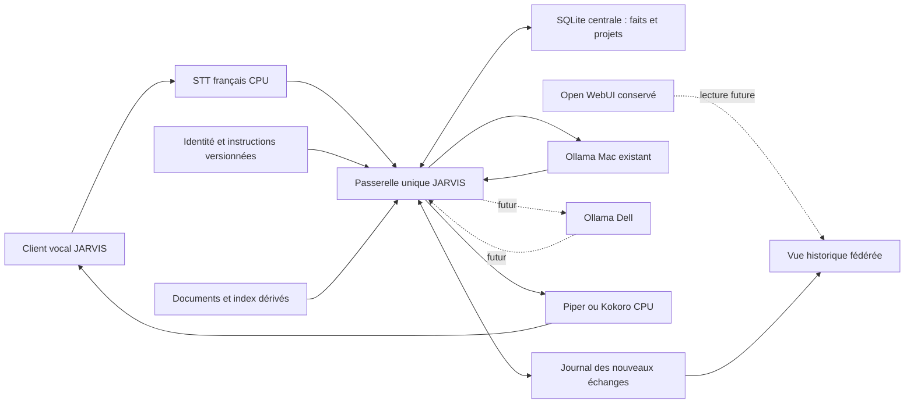

# JARVIS — Mission 12 : modules vocaux et mémoire persistante

13 octobre 2026, heure de Paris — recherches et essais CPU temporaires, sans modification du cœur JARVIS.

## 1. Synthèse exécutive

**GO sous conditions pour une première version modulaire : faster-whisper `small` multilingue CPU/int8, Piper et mémoire SQLite/FTS5 dédiée, pilotés par une seule passerelle JARVIS.** La voix **Piper `fr_FR-tom-medium` est le choix technique provisoire** ; Siwis et Kokoro restent disponibles à l’écoute. Le choix définitif du timbre et du naturel demeure **EN ATTENTE d’écoute humaine**, pas d’un problème d’installation.

Résultats concrets : **9 fichiers WAV français générés**, **9 transcriptions par Whisper base et 9 par small**, **1 test de silence small**, **16 contrôles de mémoire réussis** avec données fictives. Les essais ont réellement fonctionné sur Debian 13/Python 3.13, exclusivement sur CPU, dans `/tmp/jarvis-m12-EC3FOY`. Aucun appel de génération, d’embedding ou de téléchargement à Ollama. La mémoire commune est démontrée avec **deux profils simulés**, pas deux modèles réels.

La voix québécoise est une limite explicite : aucun `fr_CA` dans le catalogue officiel Piper inspecté ; Kokoro `ff_siwis` est français, non annoncé québécois. Un finetune **F5-TTS québécois** existe, mais ses poids sont **CC-BY-NC-4.0**, volumineux et non testés. Ne pas confondre vocabulaire québécois dans une phrase et accent québécois du locuteur.

**Mémoire retenue : SQLite structurée avec validation utilisateur**, historique de projets et recherche lexicale. Mem0 et Letta proposent des mécanismes plus ambitieux, mais ajoutent dépendances, appels LLM et règles d’écriture automatique ; ils ne résolvent pas à eux seuls la validation et les contradictions. La mémoire native d’Open WebUI peut servir de propriétaire unique dans une architecture future alternative, mais la modifier ou l’activer était interdit ici.

La passerelle conserve **identité, instructions versionnées, faits validés et journal**, indépendamment des poids, du nom du modèle et du serveur. Open WebUI reste intact. Une identité réellement commune à ses échanges et aux nouveaux échanges vocaux nécessitera un raccordement explicite ultérieur ; le nom JARVIS seul ne suffit pas.

## 2. Comparatif des solutions vocales

### État des quatre approches

| Solution | Français / voix | CPU et Debian | Navigateur / Ollama | Qualification Mission 12 |
|---|---|---|---|---|
| **Audio Open WebUI 0.12.0** | STT faster-whisper local ou service externe ; TTS local/externe selon moteur. Aucun « timbre Open WebUI » propre ; qualité dépend du moteur choisi | Fonctions dans le code existant ; disponibilité active et caches non vérifiés. Ne pas charger ses modèles audio dans le conteneur actuel | Client Web existant ; conversation Ollama déjà opérationnelle. Micro distant exige HTTPS ou localhost | **Source vérifiée, pas d’essai runtime**, car activation/configuration/cache interdits |
| **faster-whisper + Piper** | Whisper multilingue avec `language="fr"` ; voix Tom/Siwis françaises ; pas de voix québécoise officielle vérifiée | **Fonctionne réellement** avec wheels CPU dans venv temporaire, sans FFmpeg/SoX système ni sudo | Deux APIs locales à ajouter à une passerelle ; moteurs indépendants d’Ollama | **STT/TTS fichiers testés**, interface micro et chat non testés |
| **faster-whisper + Kokoro** | Même STT ; `ff_siwis` française, `lang='fr-fr'` explicite ; accent québécois non documenté | **Kokoro ONNX int8 testé**, sans PyTorch ni GPU. Ce test ne qualifie pas le serveur Kokoro-FastAPI complet | Petit adaptateur HTTP nécessaire ; compatible architecturalement avec client Web/Ollama | **Synthesis CPU testée**, naturel à écouter |
| **whisper.cpp + Piper** | Modèle Whisper multilingue, `fr`, mêmes voix Piper | C/C++ CPU, quantification et Linux documentés ; réduit les dépendances Python STT | Intégration par processus/service indépendant ; aucun besoin de changer Ollama | **Alternative de repli documentée, non compilée ni testée** |

La conclusion de Mission 11 sur les moteurs est conservée ; les nouvelles investigations ont porté sur leur exécution CPU, les voix et les dépendances exactes. Aucun nouvel audit de Jarvis Voice complet n’a été entrepris.

### Qualité, naturel et accent

Piper Tom et Siwis, ainsi que Kokoro `ff_siwis`, ont produit le même corpus de trois phrases longues : accueil, mémoire/projet, vocabulaire québécois et heure/date. Les WAV sont non silencieux, valides, mono PCM 16 bits. **Aucune note subjective de naturel/MOS ni classement auditif n’est revendiqué.** Une transcription automatique en retour évalue seulement une partie de l’intelligibilité de la chaîne TTS→STT.

Tom a le meilleur résultat lexical de ce petit corpus avec Whisper small, notamment sur « JARVIS » et « projet Atlas », et une synthèse rapide. Cela justifie sa place de candidat provisoire ; cela ne prouve pas une supériorité générale sur Kokoro ou Siwis. Les variantes de synthèse ne sont pas identiques : Piper Tom 44,1 kHz, Siwis 22,05 kHz, Kokoro ONNX **quantifié int8** 24 kHz. Le test Kokoro ne représente pas toutes les implémentations ni sa précision complète.

**Québécois :** l’inventaire figé Piper ne contient aucun chemin `fr_CA`. Kokoro officiel ne fournit qu’une voix française `ff_siwis`, avec phonémisation France. Cela ne démontre pas l’absence de tout modèle communautaire québécois ; aucun modèle léger à provenance/licence suffisamment vérifiées n’a été retenu dans le temps borné de l’étude.

Le [finetune F5-TTS québécois de tontate](https://huggingface.co/tontate/f5-tts-quebec-french-finetune) annonce une synthèse et un clonage avec prononciation québécoise. Sa carte distingue les données CC0 des poids héritant de CC-BY-NC-4.0 ; elle indique environ **1,35 Go** pour le checkpoint d’inférence et recommande un extrait de référence. Ses évaluations sont celles de l’auteur, non reproduites. Pas de téléchargement des poids, pas de clonage de voix ni d’échantillon québécois généré. **À réserver à une mission distincte si l’accent québécois devient obligatoire** ; le moteur F5-TTS est MIT, mais ce checkpoint n’est pas libre d’usage commercial. Carte publique archivée dans les preuves.

### Fonctions natives Open WebUI : précision utile

Mission 11 avait déjà identifié les routes audio ; leurs sources archivées ont été réutilisées. `routers/audio/__init__.py` contient transcription locale faster-whisper, clients STT compatibles OpenAI et clients TTS `/audio/speech`. Les deux moteurs proposés peuvent donc être exposés derrière des APIs compatibles sans changer Ollama. Piper n’est pas automatiquement un serveur compatible OpenAI : il faut écrire l’adaptateur. Le moteur SpeechT5 local visible dans le code n’est pas qualifié ici comme solution française naturelle.

L’accès actuel WebUI HTTP LAN ne garantit pas l’accès au microphone du navigateur. Pour préserver totalement sa configuration, commencer avec un client distinct sur localhost. L’accès distant requerra une origine HTTPS/authentifiée et une mission réseau autorisée. Aucun serveur Web de test n’a été démarré et aucun microphone ouvert.

Références : [audio WebUI taggé](https://github.com/open-webui/open-webui/blob/v0.12.0/backend/open_webui/routers/audio/__init__.py), [faster-whisper](https://github.com/SYSTRAN/faster-whisper), [Piper maintenu](https://github.com/OHF-Voice/piper1-gpl), [Kokoro ONNX](https://github.com/thewh1teagle/kokoro-onnx), [whisper.cpp](https://github.com/ggml-org/whisper.cpp). Les ressources de synthèse et les modèles sont figés par révision/empreinte dans les manifests, pas seulement par un lien `main`.

## 3. Comparatif des solutions de mémoire

### Quatre mécanismes distincts

- **Historique conversationnel :** archive d’échanges ; ne signifie pas que le modèle saura les retrouver ou qu’une ancienne affirmation reste vraie.
- **Mémoire structurée :** faits/préférences/états de projets, identifiés, sourcés, corrigibles et validés.
- **Mémoire documentaire/RAG :** passages de documents retrouvés et cités ; un document n’est pas automatiquement une préférence personnelle.
- **Apprentissage des habitudes :** inférences répétées à partir de preuves, avec incertitude et consentement. Ni une sauvegarde de chats, ni un embedding, ni un évaluateur LLM ne le garantissent.

Toutes les solutions considérées peuvent stocker des données hors des poids. La difficulté est de sélectionner les bonnes données, gérer les contradictions et injecter le contexte utile au bon utilisateur/projet.

### Fonctions et limites

**N = implémentation/documentation identifiée ; A = ajout/politique d’application nécessaire ; NV = fonctionnement ou qualité non vérifié. Seule SQLite a été exécutée dans cette mission.**

| Besoin | Open WebUI 0.12.0 | SQLite/FTS5 proposée | Mem0 OSS | Letta actuel / ancien MemGPT | RAG léger |
|---|---|---|---|---|---|
| Persistance entre sessions | N, base/volume existants | **Testée entre processus** | N, stockage vecteurs + historique configurable | N, état agent/MemFS ; ancienne API à distinguer | N si passages sur disque |
| Préférences personnelles | N, entrées utilisateur/context | **Testée**, clés explicites | N, faits extraits ou insertion directe | N, mémoire agent | A, peu adapté comme registre de vérité |
| Historique des projets | Paths/context ; journal métier A | **État/revisions testés**, historique détaillé A | Metadata/run scopes N ; historique métier A | MemFS/Git N ; états sémantiques A | Documents versionnés/sourcés A |
| Extraction de faits | N, revue après tour conditionnelle | A ; non testée avec LLM | N, `add(infer=True)` | N, mises à jour/réflexion agent | A, le RAG ne l’effectue pas seul |
| Proposition + validation humaine | A, pas de passage obligé identifié dans revue automatique | **Pending→approved testé** | A, `infer=False` n’est pas un dialogue de consentement | A, revue par agent ≠ utilisateur | A |
| Correction/suppression | N, IDs/opérations/routes | **Testées**, index invalidés | N, update/delete/history | N, modification mémoire/Git ; purge historique A | A/N selon implémentation passages/index |
| Contradictions | Prompt préfère remplacer ; résolution fiable NV | **Revision obsolète bloquée**, même clé ; contradictions entre clés A | LLM décide ADD/UPDATE/DELETE ; fiabilité française NV | Conflits Git/outils existent ; conflit Git ≠ contradiction factuelle | A, hiérarchie/version des sources |
| Informations périmées | Pas de TTL explicite trouvé dans modèle audité | **Expiration filtrée testée** | `expiration_date` implémenté ; audit source, NV runtime | Politique de validité A/NV | A, validité des documents |
| Recherche française | Vecteurs et recherche textuelle N ; qualité NV | **Accents café/cafe testés**, lexical seulement | Vecteurs/hybride selon backend N ; modèle multilingue requis | Mémoire/fichiers N ; qualité française/sémantique NV | **Passages FTS sourcés testés** ; vecteurs ultérieurs |
| Ollama | Déjà raccordé dans installation | Passerelle à développer ; tests simulés | Adaptateurs LLM/embedding N, version exacte NV | Provider local Ollama N ; runtime exact NV | Génération indépendante du retrieval |
| Plusieurs modèles | Même user_id pour mémoire native | **Même mémoire et identité simulées** | user_id stable nécessaire, éviter agent_id lié au modèle | Changement de modèle documenté ; conserver le même agent | Même index accessible à tous |
| Futur Dell | API/auth à qualifier | API centrale à ajouter, pas SQLite sur partage réseau | Service central à ajouter/configurer | Partage moderne documenté surtout Cloud ; local à adapter | API centrale, index dérivé reconstruisible |

### Observations dans le code, au-delà des promesses

**Open WebUI.** Les sources v0.12.0 `models/memories.py`, `utils/memory.py`, `utils/middleware.py` et routes copiées dans Mission 11 montrent des souvenirs persistants par utilisateur, des paths et des opérations add/replace/move/remove. `review_memory_after_turn` est conditionné par les capacités du modèle, la fonctionnalité mémoire, les permissions et `memories.background_review.enable`. À l’intervalle prévu, il appelle un LLM puis applique les opérations à la base. **Aucune étape de validation humaine obligatoire trouvée sur ce chemin.** La règle de remplacement des contradictions est notamment une instruction au modèle ; elle ne suffit pas à certifier son exactitude. Activation réelle et contenu privé non inspectés. [Source mémoire](https://github.com/open-webui/open-webui/blob/v0.12.0/backend/open_webui/utils/memory.py).

**SQLite/FTS5.** Déjà disponible via Python standard : SQLite **3.46.1**, FTS5 vérifié. Pas de vecteur ni de LLM nécessaire pour un fait explicitement choisi. La démo sépare faits, propositions, journal de révisions et documents ; les triggers retirent l’ancien texte de l’index. Une transaction et une révision attendue bloquent une approbation concurrente devenue obsolète. Cela traite les conflits d’une même clé, pas toutes les contradictions sémantiques. Le tokenizer français recommandé est `unicode61 remove_diacritics 2`, sans stemming Porter anglais. [Documentation FTS5](https://sqlite.org/fts5.html).

**Mem0.** Snapshot **`d26ba5e4518cef7fff3c66d4f715b21adf9feabe`**, version déclarée **2.2.1**. `Memory.add` extrait des faits puis décide leur évolution lorsque `infer=True` ; `infer=False` stocke directement, avec embeddings. `update`, `delete`, `history` et expiration existent. Les projects/scopes peuvent être représentés dans les métadonnées ; certaines APIs de projets de la plateforme ne sont pas celles du SDK OSS. Points déterminants : **l’adaptateur embedding Ollama peut appeler `pull` si son modèle manque**, et la télémétrie est activée par défaut dans le code inspecté. Aucun import/exécution Mem0 effectué. Pour un essai futur : configurer tous les moteurs locaux, désactiver la télémétrie, interdire les pulls, fixer les chemins de vecteurs et `history_db_path`, ajouter une file de propositions avec approbation utilisateur. Les modèles d’embedding Ollama peuvent évincer le modèle chat avec la limite actuelle d’un modèle chargé. [Code Mem0 figé](https://github.com/mem0ai/mem0/blob/d26ba5e4518cef7fff3c66d4f715b21adf9feabe/mem0/memory/main.py), [adaptateur embedding](https://github.com/mem0ai/mem0/blob/d26ba5e4518cef7fff3c66d4f715b21adf9feabe/mem0/embeddings/ollama.py).

**Letta.** Le dépôt `letta-ai/letta` redirige désormais vers **`letta-ai/letta-code`** ; sa branche `archive` contient le serveur V1 retiré. Snapshot actuel **`62a7610ce240c5ac8fec76b7de1c517b1accb9e3`**, package **0.34.12**. Le code mémorise dans un système de fichiers Git et permet un backend local/Ollama. Le provider inclut des préchargements possibles : raison supplémentaire de ne pas l’exécuter dans ce périmètre. L’agent peut modifier mémoire et instructions ; une identité JARVIS stable demanderait une autorité séparée et des permissions adaptées. La revue de propositions par un autre agent ne remplace pas un consentement humain. Les repositories partagés modernes documentés sont destinés aux agents Cloud ; ne pas les présenter comme une mémoire locale Mac/Dell prête à l’emploi. Plateforme entière disproportionnée pour le MVP sans shell. [Dépôt de transition](https://github.com/letta-ai/letta), [code actuel](https://github.com/letta-ai/letta-code), [mémoire/réflexion](https://docs.letta.com/configuration/memory), [partage actuel](https://docs.letta.com/concepts/shared-memory).

**RAG léger retenu comme complément, pas mémoire personnelle concurrente.** Stocker texte/passages/source/version/project_id dans SQLite et interroger FTS5 suffit à retrouver de petits documents par mots clés : démontré sur documents fictifs. Ajouter plus tard un encodeur multilingue CPU et une fusion lexical/vecteurs seulement si les tests de synonymes/reformulations le justifient. Les vecteurs sont un index dérivé, pas l’autorité des faits. Aucun modèle d’embedding supplémentaire téléchargé ni appelé.

### Ressources, licences et maintenance

| Composant | Licence vérifiée / portée | Ressources et maintenance |
|---|---|---|
| Open WebUI 0.12.0 | Licence spécifique avec clauses de marque ; déjà installé | Partage le volume actuel ; couplage aux versions applicatives ; aucune modification ici |
| SQLite/FTS5 | SQLite domaine public ; code démo original | Pas de GPU, bibliothèque standard, schéma/API à maintenir ; petits index locaux |
| Mem0 OSS | Apache-2.0 au snapshot | Python ≥3.10, clients vecteurs/LLM, SQLite historique ; option graphe additionnelle. Enveloppe **0,5–2 Gio RAM hors LLM/embedding**, estimation non mesurée |
| Letta Code | Apache-2.0 au snapshot actuel | Runtime npm/Bun et Git, état agent et appels de réflexion ; **0,5–2 Gio RAM hors modèles**, estimation non mesurée, forte évolution des APIs |
| RAG SQLite léger | SQLite + code propre ; licences des futurs embeddings distinctes | FTS peu coûteux ; sémantique CPU ajouterait typiquement **0,5–1,5 Gio**, non mesuré |
| faster-whisper | MIT ; CTranslate2/PyAV et bibliothèques intégrées ont leurs notices | Versions exactes à figer, incident PyAV démontré |
| Piper | GPL-3.0 ; licence/conditions des voix à vérifier individuellement | CPU compact ; espeak intégré, pas de paquet système requis dans cet essai |
| Kokoro ONNX | Wrapper MIT ; poids Kokoro annoncés Apache-2.0 ; notices des dépendances à conserver | Phonemizer/espeak comportent des obligations propres ; ne pas résumer l’ensemble à MIT |

Piper Siwis : carte du corpus **CC-BY 4.0**. Piper Tom : carte renvoie au corpus/projet **AGPLv3**. Ces cartes ne suffisent pas à attribuer une licence générique identique à tous les poids : **conditions du modèle Tom à confirmer avant redistribution**, sans bloquer l’évaluation personnelle réalisée. Les manifests conservent les URLs et SHA-256 des artefacts exacts.

Mem0 et Letta sont activement développés dans les sources/métadonnées consultées ; l’ancien serveur Letta V1 ne doit plus être choisi par défaut pour un nouveau projet. Aucun taux de fiabilité de leur extraction ni benchmark comparatif de mémoire « intelligente » n’a été reproduit.

## 4. Résultats des tests réellement effectués

### Isolement et versions

Venv créé **sans pip système**, puis pip utilisé depuis un wheel inspecté. Dépendances téléchargées en **wheels binaires uniquement**, sans setup.py ni compilation tierce. UID **1000**, sans sudo. Écritures d’essai dans `/tmp/jarvis-m12-EC3FOY`, preuves uniquement dans le nouveau répertoire Mission 12. Pas de modification d’environnement global.

Versions exécutées : Python **3.13.5**, faster-whisper **1.2.1**, CTranslate2 **4.8.2**, Piper **1.8.0**, kokoro-onnx **0.6.1**, ONNX Runtime CPU **1.31.0**, NumPy **2.5.4**, **PyAV 15.1.0** après correction. [Lock des wheels testés](mission12-preuves/requirements-tested-cp313-linux.txt) et [inventaire installé temporairement](mission12-preuves/installed-temporary-packages.json). Ce lock correspond à Linux x86_64/Python 3.13, pas aux dépendances du conteneur Open WebUI.

Workers bornés à deux processeurs logiques, priorité réduite, une inférence à la fois ; `CUDA_VISIBLE_DEVICES=-1`, providers CPU explicites, réseau refusé pendant l’inférence. Watchdog : 180 s par worker, arrêt au-delà de 2 Gio RSS ou si la RAM disponible de l’hôte descend sous 6 Gio. Aucun seuil franchi. Les modèles vocaux sont des fichiers séparés ; aucun poids Ollama modifié. Aucun modèle n’a reçu shell, SSH, sudo ou accès Docker.

Téléchargements ML + wheels : environ **1,095 Go décimaux**, budget final borné à **1,2 Gio**. L’enveloppe initiale de 650 Mio a été augmentée une seule fois, pour comparer Whisper small après les erreurs observées avec base. Le checkpoint F5 québécois et ses dépendances n’ont pas été téléchargés. Le temporaire est en tmpfs et reste non déployé.

### Mesures CPU sur le Mac

RTF = durée de traitement / durée audio : **plus petit est plus rapide**, 0,1 signifie environ une seconde de calcul pour dix secondes de son. RSS = mémoire du processus échantillonnée toutes les 20 ms, pas consommation totale de l’installation.

| Test | Corpus | Chargement mesuré | Temps par extrait | RTF médian | Pic RSS observé |
|---|---|---:|---:|---:|---:|
| Piper Siwis | 3 synthèses, audio 7,1–8,8 s | 3,24 s | 0,34–0,42 s | **0,048** | **312 Mio** |
| Piper Tom | 3 synthèses, audio 7,8–10,1 s | 3,42 s | 0,71–0,91 s | **0,091** | **444 Mio** |
| Kokoro ff_siwis ONNX int8 | 3 synthèses, audio 7,4–9,3 s | 0,82 s | 3,27–4,09 s | **0,440** | **431 Mio** |
| Whisper base CPU int8 | 9 transcriptions synthétiques | 0,36 s | 0,68–0,74 s | **0,086** | **601 Mio** |
| Whisper small CPU int8 | Mêmes 9 transcriptions | 0,69 s | 2,13–2,27 s | **0,264** | **1 263 Mio** |

Les modèles Piper ont été chargés puis leurs sessions recréées avec limites de threads explicites : leur temps de chargement inclut cette double création et n’est pas un benchmark optimisé de démarrage. Le serveur final devra garder chaque moteur résident. Les RSS de workers distincts ne prouvent pas le pic de tous les services simultanés.

**Intelligibilité de la chaîne :** taux lexical brut TTS→STT de **16,7 % avec base**, **15,3 % avec small** sur l’ensemble. Ce chiffre inclut les nombres transcrits en chiffres au lieu de mots : « dix-sept heures trente » → « 17h30 » compte comme erreur lexicale dans cette mesure, même si le sens est juste. Ponctuation retirée, minuscules, accents conservés. Trois textes × trois voix, pas un corpus représentatif ni un benchmark de reconnaissance humaine.

Avec small, le passage mémoire donne **4 % d’erreur brute pour Tom**, **8 % pour Kokoro**, **32 % pour Piper Siwis**. Des erreurs restent sur « décaféiné », « Atlas », « JARVIS » selon voix/modèle. Ce petit résultat favorise Tom comme candidat, mais ne sépare pas complètement défaut de synthèse et défaut de reconnaissance. **Ne pas écrire automatiquement un souvenir à partir d’une transcription non validée.** Montrer le texte et la valeur proposée avant enregistrement.

Test complémentaire : deux secondes de silence numérique, small, langue `fr`, sans VAD externe → **transcription vide**, essai réussi. Pas de test de bruit, d’écho, de vrai micro ou de locuteur québécois. Le corpus « Québec lexique » est lu par des voix françaises ordinaires et n’établit pas un accent québécois.

### Incidents et corrections conservés

1. Le fichier de vocabulaire Whisper est `vocabulary.txt`, pas `vocabulary.json`. Premier chargement échoué ; fichier exact trouvé dans l’inventaire du modèle et ajouté, sans conversion ni exécution de code distant.
2. **PyAV 19.0.1**, sélectionné par les contraintes larges de faster-whisper, rejette `metadata_errors` dans `av.open`. Deuxième essai échoué avant transcription. **PyAV 15.1.0**, déjà identifié dans les dépendances étudiées en Mission 11, a été inspecté et installé uniquement dans le venv temporaire ; le même chemin WAV fonctionne ensuite.
3. Certaines URLs docs Letta/Mem0 anciennes ont échoué ou redirigé. L’étude utilise les sources figées et la documentation actuelle, sans présenter les anciennes APIs comme actuelles.

Les deux premières erreurs sont **RÉSOLUES dans l’essai**, avec logs conservés ; elles ne doivent pas être masquées par un simple « installation réussie ».

### Mémoire fictive : 16/16 contrôles

[Résultats JSON](mission12-preuves/memory-results.json), [démo source](mission12-preuves/memory_demo.py), base fictive et journal dans les preuves.

| Situation demandée | Résultat et portée |
|---|---|
| 1. Préférence explicitement demandée | Proposition « boisson = thé vert », invisible avant validation, puis enregistrée |
| 2–3. Fermer/rouvrir, retrouver | Nouveau processus Python indépendant retrouve la préférence depuis SQLite |
| 4–5. Corriger, une version active | « café décaféiné » remplace la valeur ; seule valeur corrigée récupérable, ancien terme retiré du FTS |
| 6–7. Supprimer, ne plus restituer | Valeur retirée du contexte et de la recherche ; nouveau processus confirme l’absence |
| 8. Deux modèles/profils | **SIM-Llama et SIM-Qwen** reçoivent les mêmes faits et instructions ; **aucun modèle réel appelé** |
| Compléments | Révision concurrente obsolète refusée ; scope utilisateur/projet filtré ; expiration exclue ; état projet corrigé et événements de révision ; passages documentaires avec source |

L’extraction LLM n’est pas simulée comme si elle était fonctionnelle : les propositions sont construites explicitement par le scénario. Les profils simulés prouvent l’indépendance du stockage et du contexte construit, **pas l’obéissance ou la qualité de deux LLM**. Aucun reboot : la réouverture est interprocessus. `/tmp` étant en RAM, cette base d’essai n’est pas une installation durable ; le déploiement doit placer sa base sur disque. La copie de preuve n’est pas une base applicative active.

Benchmark FTS séparé : **10 000 documents fictifs**, 100 recherches retournant cinq résultats ; base **827 392 octets**, médiane **9,06 ms**, p95 **12,50 ms**. Démo complète : base **61 440 octets**, RSS courante environ **25,5 Mio**. Les métriques `rusage` héritées incluaient un pic antérieur et ne sont pas utilisées comme pic réel de la démo ; les mesures audio proviennent du watchdog `/proc`.

Ce test valide le retrieval lexical, pas sémantique : `batterie` est trouvé, son synonyme `pile` ne l’est pas. Pas de chiffrement, API authentifiée, crash/recovery ou effacement forensic qualifié. Supprimer le fait actif ne purge pas automatiquement les anciens historiques ou les sauvegardes ; prévoir une politique de purge et empêcher la réextraction d’une ancienne valeur supprimée.

## 5. Échantillons audio disponibles

**[Lecteur local des neuf extraits](mission12-preuves/ecoute.html)** : ouvrir ce fichier dans un navigateur, sans serveur et sans microphone. Aucun appel réseau dans ce lecteur.

| Candidat | Accueil | Préférence et projet | Lexique québécois / heure |
|---|---|---|---|
| Piper Tom | [WAV](mission12-preuves/audio/piper-tom-accueil.wav) | [WAV](mission12-preuves/audio/piper-tom-memoire.wav) | [WAV](mission12-preuves/audio/piper-tom-quebec_lexique.wav) |
| Piper Siwis | [WAV](mission12-preuves/audio/piper-siwis-accueil.wav) | [WAV](mission12-preuves/audio/piper-siwis-memoire.wav) | [WAV](mission12-preuves/audio/piper-siwis-quebec_lexique.wav) |
| Kokoro ff_siwis | [WAV](mission12-preuves/audio/kokoro-ff_siwis-accueil.wav) | [WAV](mission12-preuves/audio/kokoro-ff_siwis-memoire.wav) | [WAV](mission12-preuves/audio/kokoro-ff_siwis-quebec_lexique.wav) |

Textes exacts : [corpus](mission12-preuves/corpus.json). Les neuf extraits ont été générés sur place, pas téléchargés depuis une démo marketing. Aucun extrait québécois F5 disponible. Écouter surtout la prononciation de JARVIS, décaféiné, Atlas et des dates ; choisir ensuite agrément, fatigue à l’écoute, débit et timbre. Les WAV ne sont pas normalisés à une sonie commune : régler un volume comparable avant jugement.

## 6. Architecture cible voix + mémoire

### Propriétaire de l’identité et des souvenirs

**La passerelle JARVIS est l’autorité.** Elle conserve une définition versionnée sur disque : nom, langue, comportement, règles de mémoire et permissions. Cette définition n’est pas éditable par le modèle. Elle récupère les faits validés puis prépare un contexte borné, avec `user_id` et `project_id` stables. Le choix `(serveur, modèle)` est un paramètre de routage ; jamais une clé de partition mémoire.

Contrats proposés : `transcribe(audio) → texte`, `retrieve(user, project, query) → faits sourcés`, `propose → approve/reject`, `correct(id, revision)`, `forget(id)`, `chat(messages, model) → content`, `speak(text, voice) → audio`. Toute mémoire injectée est étiquetée comme donnée et ne peut créer une autorisation d’outil. Aucun shell ou automatisation système dans le MVP.

Le modèle suggère éventuellement un souvenir, mais **seule la passerelle applique une écriture validée**, sur une proposition exacte et une révision vérifiée. Préférer un accord par bouton au début : une simple détection vocale de « oui » peut être fausse. Corriger signifie invalider ancienne valeur, index et caches ; supprimer signifie aussi empêcher l’historique de réintroduire cette valeur. Les hypothèses d’habitude restent proposées et non actives tant qu’elles ne sont pas confirmées.

Pour le Dell, garder initialement la mémoire sur le Mac et exposer une API authentifiée à la passerelle/clients autorisés. Le Dell exécutera seulement l’inférence ; son remplacement ne change pas l’identité. Ne pas partager directement un fichier SQLite en écriture entre machines ; la sauvegarde/export est distincte de la réplication.

### Éviter deux mémoires et deux personnalités

Ne pas activer à la fois une extraction indépendante dans Open WebUI, Mem0 et la passerelle. **Un seul propriétaire des faits actifs et une seule définition d’identité**, les autres composants n’étant que des clients/index dérivés. Ni la voix ni le modèle conversationnel ne possèdent la mémoire canonique.

Sous les contraintes actuelles, Open WebUI continue à fonctionner comme avant ; ses profils qualité ne sont pas automatiquement repris par un appel direct Ollama. **Une personnalité et une mémoire identiques dans ses chats existants et dans la nouvelle interface ne sont pas garanties sans raccordement.** Le futur plan devra soit faire passer les échanges JARVIS par la passerelle, soit adopter exclusivement la mémoire native WebUI et faire la voix cliente de celle-ci. La seconde option demanderait des réglages applicatifs aujourd’hui interdits. Aucun réglage mémoire de WebUI n’a été lu/modifié pendant l’essai ; son éventuelle activation actuelle reste EN ATTENTE.

### Historique unifié sans altérer la base WebUI

Une **vue fédérée en lecture seule** est possible : nouveaux échanges dans le journal JARVIS ; anciens échanges obtenus via APIs authentifiées WebUI, identifiés par `(source, id)`. Afficher une seule chronologie sans importer ou réécrire ses lignes. Les routes `/api/v1/chats/list` et `/{id}` sont présentes au tag audité ; les handlers consultés sont des chemins de lecture, avec permissions. Les éventuels effets indirects/auth/caches devront être qualifiés avant usage réel ; aucun chat privé n’a été consulté ici.

Cette vue unifiée ne signifie pas stockage physique unique ni reprise automatique de contexte : une conversation reste liée à sa source, et tout contexte transféré vers le modèle doit respecter correction/suppression et les droits. Pas d’accès direct à `webui.db` active. **Créer/importer les nouveaux chats dans WebUI modifierait sa base**, même via API officielle : cette autre stratégie ne satisfait pas la contrainte stricte actuelle. Routes étudiées dans [chats.py taggé](https://github.com/open-webui/open-webui/blob/v0.12.0/backend/open_webui/routers/chats.py).

## 7. Estimation des ressources et des efforts

**Budget initial conseillé : 2–3 Gio RAM additionnels**, CPU borné à deux threads pour chaque moteur, **zéro VRAM vocale**, **2–4 Go de disque** hors audio/historiques/documents. Les voix et le STT sur disque représentent environ 550 Mo pour small + un Piper ; venv/caches/archives peuvent doubler ce total. Les pics séparés mesurés ne remplacent pas un test de coexistence STT/TTS/chat.

Référence Qwen conservée de Mission 10 : pic 17 489 Mio sur 24 576 Mio, contexte 8192. **Aucune mesure de concurrence vocale avec Qwen chargé** : elle aurait pu perturber l’état Ollama. L’approche CPU évite une demande de VRAM supplémentaire mais ne garantit pas absence de contention CPU/thermique. Les performances du futur Dell ne sont pas extrapolées de cet essai.

Pour une entrée de 8–10 s, small a pris environ 2,2 s de transcription sur les fichiers synthétiques ; Piper Tom ajoute moins d’une seconde pour une réponse similaire. L’attente totale dépend surtout de la génération Ollama, non mesurée ici. Kokoro ajoute environ 3–4 s dans cette configuration CPU int8. Préférer des réponses courtes et garder les moteurs résidents ; le streaming par phrases pourra réduire l’attente perçue plus tard.

| Travaux futurs | Effort indicatif pour un développeur | Validation attendue |
|---|---:|---|
| Passerelle locale STT/TTS/Ollama + client appui pour parler | 1–2 jours | Micro réel, réponses françaises, timeouts, aucun outil système |
| Mémoire sur disque + CRUD/validation + journal | 0,5–1 jour | Reprise après arrêt processus, correction/suppression, même contexte avec deux modèles autorisés |
| Accès distant HTTPS/auth | 0,5–1 jour | Navigateur réel, auth, micro, aucune exposition directe d’Ollama |
| Vue historique WebUI en lecture seule | 1–2 jours | Permissions et absence d’écriture qualifiées, aucune importation active |
| Extraction/contradictions/habitudes et RAG sémantique | 2–5 jours selon périmètre | Corpus français, propositions validées, projets isolés, purge dérivés |

Total MVP local : **2–3 jours utiles**, sous réserve de voix choisie et d’essais Ollama autorisés. Les tests temporaires n’ont pas construit une interface vocale complète. Les durées sont des estimations d’intégration, pas des mesures ni un engagement de calendrier.

## 8. Recommandation des composants retenus

1. **STT : faster-whisper 1.2.1, modèle `small` multilingue, CPU int8, langue `fr`, deux threads.** PyAV **15.1.0** fixé dans l’environnement propre. Base reste une option de latence, pas le choix qualité initial ; aucune preuve générale qu’un modèle plus grand serait nécessaire.
2. **TTS : Piper 1.8.0.** Tom candidat technique initial ; Siwis alternative simple déjà étudiée en Mission 11. **Choix auditif final à faire parmi les WAV.** Kokoro ONNX int8 `ff_siwis` est une alternative réellement fonctionnelle si son rendu plaît davantage et si 3–4 s de synthèse sont acceptables.
3. **Mémoire : SQLite/FTS5 dédiée, faits et projets structurés, validation explicite, revisions, expiration, provenance et tombstones.** Aucun embedding Ollama pour le MVP.
4. **Documents : SQLite passages/FTS avec sources**, séparés des faits personnels ; moteur vectoriel multilingue CPU seulement après test utile.
5. **Orchestration : petite passerelle JARVIS**, identité immuable par le modèle, APIs internes simples. Ne pas intégrer Jarvis Voice complet, Mem0 ou Letta pour la première version.
6. **Open WebUI : conservé**, accès historique éventuel en lecture seule après qualification ; raccordement identité/mémoire sous mission distincte.

**NO-GO pour les écritures automatiques de souvenirs, l’apprentissage implicite d’habitudes et les outils système dans le MVP.** **GO sous conditions pour le déploiement modulaire** : nouvelle autorisation d’installation durable, sélection de voix et validation du vrai micro/chat. Ce ne sont pas des blocages à la livraison de cette étude.

## 9. Plan concret de déploiement proposé

Toutes les étapes suivantes sont un plan, **pas exécutées ni autorisées au-delà des essais temporaires de Mission 12**.

- **13A — socle indépendant sur disque.** Nouveau répertoire applicatif, venv dédié à partir du lock testé, moteurs et révisions figés. CPU exclusivement ; pas de changement des unités existantes. Reproduire les neuf synthèses et la transcription après fermeture/réouverture du processus. Aucun `.env` existant réutilisé ou écrasé.
- **13B — passerelle et voix locale.** Client appui pour parler sur localhost, état écouter/transcrire/générer/parler, micro désactivé pendant TTS, transcription visible et éditable. Appeler le modèle existant autorisé via `/api/chat`, sans `pull`, changement de poids, tools ou shell. Les essais susceptibles de charger un modèle exigent un périmètre explicite différent de Mission 12. Ne lire que le contenu final, pas `thinking`.
- **13C — mémoire commune durable.** API mémoire propriétaire, user/project constants, validation des propositions, correction et suppression transactionnelles, journal borné et export portable. Tests fictifs avec deux modèles successifs **dans une fenêtre autorisant leurs chargements**, puis arrêt/reprise du service nouveau. Reboot physique exclu tant qu’il n’est pas autorisé ; persistance disque validée par réouverture et sauvegarde restaurée dans une copie isolée.
- **13D — accès distant.** Étudier puis autoriser HTTPS/auth et ports dédiés. Garder Ollama sur boucle locale. Ne pas reprendre un Compose bridge incompatible avec la configuration Docker actuelle. Pour un MVP, service indépendant sur l’hôte sans socket Docker suffit ; aucune nécessité d’un conteneur GPU.
- **14 — identité et historique communs avec WebUI.** Qualifier les GET et droits, chronologie fédérée, accès sans modification des anciens chats. Décider du propriétaire unique de mémoire avant tout raccordement. Si une modification de configuration WebUI devient nécessaire, la proposer séparément avec sauvegarde/retour arrière et autorisation.
- **15 — mémoire avancée.** Extraction de faits en mode proposition, corpus français/québécois réel consenti, contradictions inter-clés, périmption, RAG sémantique et suppression dérivée. Dell et automatisations avancées restent des missions ultérieures.

Critères de réception MVP : dix tours vocaux réels, aucune réponse au silence/bruit bref, mémoire après reprise, correction non doublonnée, suppression non réinjectée, même identité et faits avec deux modèles autorisés, ancien WebUI intact. Retour arrière : arrêter seulement les nouveaux processus et retirer seulement leurs composants, conserver mémoire/export ; aucun `compose down -v`, aucune restauration ancienne sur la base active.

## 10. Points EN ATTENTE et limites

| Sujet | Pourquoi / preuve disponible | Suite |
|---|---|---|
| **Voix définitive naturelle et agréable** | Aucun jugement auditif humain pendant mission ; 9 WAV disponibles | Écoute Tom/Siwis/Kokoro ; choix et réglage débit/prononciation |
| **Accent québécois TTS** | Aucun Piper fr_CA officiel vérifié, Kokoro France ; F5 spécialisé non testé/NC | Mission dédiée si obligatoire, licence et coût à qualifier |
| **Micro, bruit, écho, navigateur** | Tests fichiers seulement, aucun micro ouvert | Client localhost puis navigateur distant autorisé |
| **Reconnaissance réelle français/québécois** | Corpus synthétique non représentatif, erreurs résiduelles | Petit corpus consenti ou fictif lu humainement, chiffres/noms propres |
| **Voix→mémoire→Ollama complète** | Génération/embedding/pull Ollama exclus pour préserver les chargements | Mission 13B/C explicitement autorisée ; profils actuels non modifiés |
| **Mémoire après reboot physique** | Reboot interdit ; réouverture interprocessus réussie ; essai tmpfs | Base durable sur disque, arrêt/reprise et restauration isolée ; reboot seulement autorisé |
| **Sémantique, extraction et habitudes** | FTS et propositions structurées testés, pas LLM extracteur | Corpus/test 15 ; aucune déclaration d’apprentissage fiable |
| **Mem0/Letta runtime** | Audit statique seulement ; auto-pull/preflight et dépendances incompatibles avec périmètre | Non nécessaires au MVP ; essai futur si gain quantifié |
| **Mémoire unique dans WebUI** | État mémoire/config active non examiné ni modifié | Choix d’autorité unique et raccordement spécifique |
| **Historique fédéré** | Routes étudiées, pas de compte/token/API privée utilisé | Qualification en lecture seule et UX ; pas de promesse de base unique |
| **Suppression complète et données dérivées** | Effacement logique/contextuel testé ; pas purge forensic/backups/chat | Politique de rétention, tombstones et invalidation des résumés |
| **Conditions des poids Tom / redistribution** | Carte corpus/projet AGPLv3, moteur GPL ; portée exacte des poids à clarifier | Usage personnel d’essai réalisé ; vérifier avant partage produit |
| **Coexistence GPU/RAM avec Qwen** | Workers CPU séparés ; aucune inférence Ollama | Test de charge autorisé, pas changement pilote/CUDA |
| **Dell** | Architecture future, machine non opérationnelle dans cette mission | API mémoire centrale ; aucun déploiement ici |

### Temps, conformité et preuves

Début : **12 octobre 2026 22:18:28 UTC**, soit 13 octobre 00:18:28 à Paris. Finalisation anticipée après les essais ; durée largement inférieure au maximum **4 h + 1 h**. La fin horodatée et les contrôles d’intégrité sont dans [README des preuves](mission12-preuves/README.md).

Les empreintes de **quatre fichiers de référence** (Compose, deux unités JARVIS, Mission 11) sont identiques avant/après ; les deux services restent actifs ; `/api/ps` n’affiche aucun modèle chargé au début ni à la fin. **Cette égalité de snapshots ne constitue pas un monitoring continu ni un hash de la base WebUI.** Aucun accès au volume ou à la base privée, aucun appel de génération à Ollama, aucune activation audio WebUI, aucun Docker/sudo/reboot/changement réseau/pilote/CUDA/systemd/modèle. Seuls les composants temporaires et nouveaux livrables ont été écrits.

Les scripts originaux de démo et de mesure, logs de succès/échec, sources publiques figées, manifests de téléchargements et locks sont conservés dans [mission12-preuves](mission12-preuves/README.md). Les modèles binaires et le venv restent temporaires ; les WAV, sources et résultats sont sur disque dans les preuves. Aucun secret ni information personnelle réelle enregistré dans la mémoire de test. Le rapport distingue possibilités architecturales, chemins implémentés et essais exécutés.
