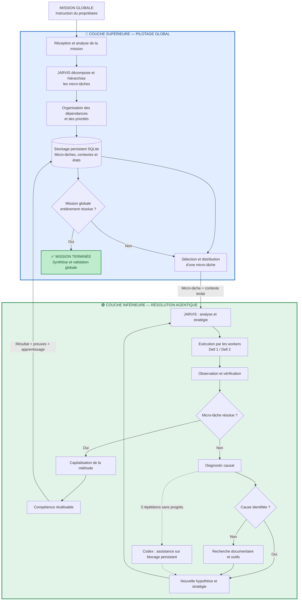

# Architecture agentique JARVIS — Diagramme validé par le propriétaire

**Validation graphique et fonctionnelle : 25 octobre 2026.**
**Statut : conception approuvée pour documentation, non assimilée à un déploiement.**

Cette représentation est le dernier diagramme explicitement accepté par le propriétaire. Respecter sa disposition : **couche bleue supérieure : mission complète, décomposition et distribution** ; **couche verte inférieure : résolution agentique de chaque micro-tâche**. Le contrôle de clôture globale se trouve dans la couche bleue.

## Principes actés

- La couche supérieure reçoit la mission, produit et stocke un plan hiérarchisé, transmet une **micro-tâche et son contexte limité** à la couche verte.
- La couche verte exécute, vérifie et résout localement ; la protection contre les répétitions est appliquée à la **micro-tâche**, sans arrêter la mission globale.
- Après résolution, résultats, preuves et apprentissages remontent dans le stockage canonique.
- La couche supérieure décide si la **mission globale est entièrement résolue** : si non, elle distribue la suite ; si oui, elle synthétise et clôture après validation globale.
- Codex n'est sollicité que pour l'assistance sur un blocage persistant, sans se substituer systématiquement à la capacité agentique de JARVIS.
- Ce diagramme représente la **cible validée de conception**, et non une affirmation d'installation ou de réussite technique.

**Sources normatives relues :** `AGENTS.md`, `docs/CHARTE_DIRECTIVES_JARVIS.md`, `docs/architecture/P0-P3-2026-10-25/PRIORITES-ET-PROGRESSION.md`. Les missions existantes et leurs états documentés restent inchangés.
