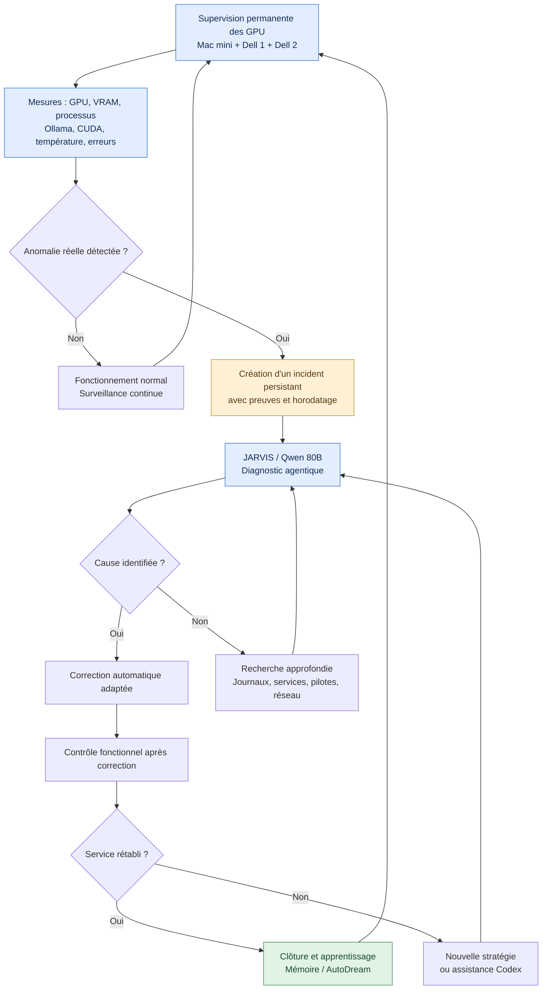

# Architecture proposée — supervision et diagnostic agentique des GPU (P7)

**Statut : architecture proposée, documentée le 27 octobre 2026 ; ni installée ni réceptionnée par cette publication.**

Ce document complète [P7 — surveillance GPU et dépendances](P7-SURVEILLANCE-GPU-INCIDENTS-AGENTIQUES.md). Il ne modifie ni la mission 26 phase 2 en cours ni les missions historiques ; il ne crée pas de second moteur de missions.

## Diagramme fonctionnel — détection, diagnostic, correction et réception

Le diagramme exprime des **flux fonctionnels souhaités**, pas l'existence déjà démontrée de tous ces services. Les retours `I → F` et `M → F` sont soumis à la machine d'états et aux compteurs persistants **P2** : aucune répétition infinie, ni remise à zéro artificielle en renommant la tâche.

## Intégration à l'architecture JARVIS

- **Sondes légères indépendantes de l'IA** : métriques et contrôles par hôte, y compris lorsque Qwen est inaccessible. Le Mac mini conserve l'orchestration, les événements et les preuves ; réutiliser les composants de supervision existants si techniquement appropriés.
- **Machine réelle** : Mac mini eGPU RTX 3090 ; Dell 1 deux RTX 3090 ; Dell 2 RTX 3090 + RTX 3080. Total **cinq GPU physiques**, pas cinq RTX 3090. Dell 2 a CUDA validé ; son inférence Ollama n'est pas encore prouvée dans les missions consultées.
- **Critère d'anomalie** : croiser un calcul *attendu* avec son absence de progression (inférence, job, file) et l'état de l'infrastructure. VRAM vide, GPU inactif, ou déchargement Ollama normal ne suffisent pas à eux seuls.
- **Incident persistant** : horodatage, hôte, identifiant GPU, symptôme, mission/tâche affectée, derniers progrès, provenance des relevés et références de journaux, dans les stockages canoniques existants.
- **Agent décisionnaire** : Qwen choisit diagnostic, inspections et corrections possibles. Si le Dell 1 qui héberge Qwen est indisponible, conserver l'incident indépendamment du modèle ; n'invoquer un autre moteur que si réellement disponible, configuré et prouvé.

## Liens avec les priorités opérationnelles

| Priorité | Rôle dans le schéma | Conséquence |
|---|---|---|
| **P2 — Règle des trois boucles** | Gouverne les retours de diagnostic / tentatives | Distinguer panne infra, échec métier, absence d'exécution ; après stagnation changer réellement d'approche, escalade si nécessaire. |
| **P3 — Gestion durable du contexte** | Prépare F / I | Contexte compact, checkpoints, références aux preuves ; ne pas transmettre tous les journaux ni dépasser le budget avant inférence. |
| **P4 — Code réel** | Gouverne H et son périmètre | Confirmer processus/service/version active et cause ; ne pas confondre candidat ou test sur copie avec la réparation de l'application réellement en service. |
| **P5 — Contrats de réception** | Gouverne J / K / L | Clôture uniquement sur preuve de reprise fonctionnelle de la charge concernée, pas sur un simple HTTP 200, PID présent ou VRAM allouée. |
| **P6 — Visibilité JL-03** | Affiche A–M | Mesures réelles, incidents, décisions, interventions, preuves et états. |
| **P7 — Supervision GPU** | Détecte A–E, déclenche le diagnostic | Surveille les cinq GPU, distingue repos et panne, transmet au moteur existant. |
| **P9 — Autonomie** | Gouverne M | JARVIS réalise les diagnostics accessibles ; Codex n'intervient que sur escalade justifiée / besoin structurant démontré. |

## Réception future minimale

1. Différenciation prouvée de l'inactivité normale et de l'arrêt d'une charge attendue.
2. Détection attestée de trois classes : service d'inférence arrêté, GPU/nœud injoignable, inférence sans progression.
3. Incident persisté avec preuves et récupération après redémarrage ; micro-tâche créée dans le **Mission Engine existant**.
4. Diagnostic agentique Qwen tracé, gestion P2 des trois cycles respectée.
5. Validation P5 indépendante du rétablissement réel et reprise de la mission interrompue, sinon incident laissé ouvert.

## État historique vérifié au moment de la rédaction

Dans la [PR #29](https://github.com/regisazzoun/JARVIS-Local-AI-Lab/pull/29), P2 et P3 de la mission 26 phase 2 sont reçues **avec réserves** ; P4 est lancée, **non réceptionnée** dans le rapport lu. La présente documentation ne change pas ces états et ne commande aucune action sur les systèmes.
