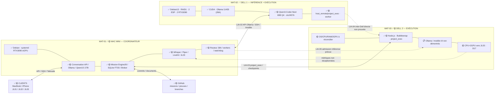

# Diagramme JARVIS — vue couches physiques, applicatives et fonctionnelles

**État documentaire au 25/10/2026**, source du rendu vectoriel V2. Les flèches continues représentent les liens réellement utilisés dans le périmètre de leur mission ; les pointillés un usage prévu ou non démontré. `✅🟡` signifie acquis avec réserves.

**Attention :** deux Dell comme exécutants ne veut pas dire équilibrage d'inférence. Le diagramme distingue les deux canaux. Le propriétaire confirme le Dell2 déployé ; les fonctions exactes et l'activation GPU IA restent à documenter séparément.

Voir [inventaires et sources](PRIORITES-ET-PROGRESSION.md), [diagnostic des boucles](ANALYSE-BLOCAGES-ET-BOUCLE-CONTROLE.md).
