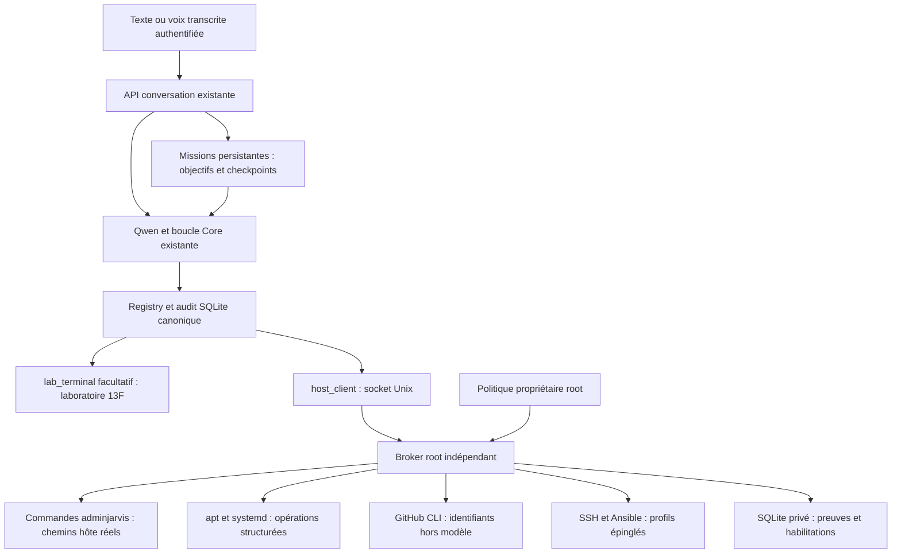

# Architecture mission 11

Le registre 13F, la boucle Ollama, le backend vocal, l'authentification et la mémoire canonique sont réutilisés. La politique 13F reste celle de lab_terminal ; elle ne limite pas les outils hôte de mission 11.

## Autorité effective

`/etc/jarvis/host-policy.json` appartient à root et n'est pas inscriptible par l'agent. Le broker vérifie UID propriétaire et absence d'écriture groupe/autres. Le socket n'accepte que root et adminjarvis via SO_PEERCRED. Il ne reçoit aucune commande de modification de sa politique. L'identité technique adminjarvis est réutilisée ; aucune création de compte.

Le service conversation garde son confinement systemd. Un service distinct activé au boot, avec notification READY après création du socket, porte le socket `/run/jarvis-host/bridge.sock`. Les secrets GitHub, clés SSH et authentification conversation ne sont jamais montés dans host_exec. Les actions apt et systemd ne prennent pas de shell root. Les services conversation/Ollama/WebUI sont consultables ; le service de preuve dédié est administrable sans toucher au déploiement Dell. Pour accorder un autre service ou chemin : modification explicite de la politique par Codex dans les autorisations déjà acquises, puis sonde demandée par Qwen.

`host_exec` utilise encore Bubblewrap comme mécanisme de masquage des secrets et de restriction des montages, mais ses montages RW sont les chemins réels hôte : `/var/lib/jarvis/projects`, `/etc/jarvis/managed`, `/home/adminjarvis/JARVIS/agent-workspaces`. Il ne s'agit ni du `/work` 13F, ni d'une copie de fichiers. La racine de cette vue est remontée en lecture seule ; seuls les montages RW explicitement accordés et le temporaire de processus sont inscriptibles. Une écriture de configuration hors montages autorisés échoue ; elle ne peut pas être annoncée comme une modification hôte persistante. Les binaires installés sur Debian deviennent immédiatement disponibles ; le réseau hôte est utilisable. Le modèle ne dispose pas d'un shell root général. L'administration privilégiée passe par les opérations structurées. Ce choix et sa portée doivent être exposés sans prétendre donner accès arbitraire à tout `/etc`.

## GitHub et accès distants

GitHub CLI réutilise l'authentification locale existante. Le modèle sélectionne un dépôt autorisé et une action structurée ; aucune action `auth token` ou `gh api` arbitraire n'est exposée. Pour publier, le broker crée une copie Git propre, importe le fichier explicite depuis les montages autorisés puis commit/push sur une branche dédiée. Il n'exécute pas les hooks ou credential helpers d'un dépôt modifiable par le modèle. Pas de push main ni fusion. Les fichiers de workflows peuvent être publiés ; les secrets apparents sont refusés. Création de dépôt et activation Pages limitées à Launcher2. Une publication Pages réelle exige encore un contenu/une branche source lors de JL-02.

Un profil SSH local utilise une nouvelle clé technique root privée, autorisée uniquement depuis loopback, sans retirer les clés antérieures. Clé serveur épinglée depuis la clé publique locale. Les actions prédéfinies, le déploiement de fichiers, les installations apt autorisées et le contrôle des services accordés sont disponibles via SSH/Ansible ; les sondes et le déploiement de fichiers valident le transport sans contacter le Dell engagé. Cela ne prouve pas l'administration d'une machine distante distincte. L'activation d'autres machines exige identité vérifiée, profil autorisé et test indépendant. Aucun inventaire découvert ne confère automatiquement un droit.

## États, reprise et apprentissage

- `runtime/memory.sqlite` reste inchangée dans son schéma et conserve souvenirs/préférences/historiques. tool_audit existant et tool-traces.jsonl restent utilisés.
- `runtime/missions.sqlite` contient objectifs, état, tentatives, checkpoints, graphe de tâches, dépendances et procédures techniques. `/api/missions` authentifié permet soumission et suivi. Le worker ne concurrence pas une conversation active.
- Au démarrage du service, les missions running retournent en queued ; Qwen reçoit les dernières observations et doit réobserver avant toute action. Une opération ayant réussi juste avant interruption peut manquer de checkpoint : aucune garantie exactly-once. Les effets externes doivent être revérifiés.
- `mission_plan` valide un graphe sans cycle ; `mission_task_complete` exige une preuve hôte réussie issue de la conversation et des dépendances déjà validées. La progression compte les tâches validées. Une preuve de commande réussie ne garantit pas, seule, la qualité sémantique du résultat : réception indépendante conservée.
- `procedure_save` n'accepte une procédure qu'après au moins une tâche validée. C'est une connaissance technique, pas une autorisation. Les procédures sont consultables par mission_progress et réutilisables par Qwen.
- L'exécution des outils dans Core reste séquentielle. Les sondes matérielles sont parallèles ; host_exec permet les commandes indépendantes parallèles. Pas de plusieurs conversations Qwen simultanées ni d'ordonnanceur distribué.
- Les plans conservent leurs identifiants ; une nouvelle proposition ne recrée pas de tâches déjà enregistrées. Les preuves peuvent être référencées par evidence_id ou last_success, y compris depuis les checkpoints de la même mission après reprise. Une mission avec rapport mais sans graphe entièrement validé est `reported`, pas automatiquement réussie. `completed` signifie rapport + tâches validées ; le verdict de réception reste indépendant. Une limite de boucle sans rapport provoque une continuation bornée à cinq tentatives ; POST /api/missions/resume permet ensuite une reprise explicite authentifiée. Les missions dont les tâches sont déjà validées reçoivent une consigne de clôture sans recréer la panne.

## Demandes à Codex

`capability_request` exige capacité, mission, cible, accès nécessaire, diagnostic, solution, test et persistance. Une demande est inscrite dans `/var/lib/jarvis-agent/state.sqlite`, table requests. Les états prévus sont DISPONIBLE, MANQUANT, DEMANDÉ, INSTALLÉ, VALIDÉ, ÉCHEC ; DISPONIBLE désigne une disponibilité observée, jamais une simple modification de configuration.

Codex consulte cette file avec les commandes de maintenance. Il vérifie le périmètre propriétaire, applique la correction autorisée et restitue une résolution. Qwen relit capability_status puis déclenche capability_test. Cette sonde fixe est exécutée côté broker ; une affirmation libre du modèle ne peut marquer VALIDÉ. Les grants survivent aux redémarrages et ne sont pas réinitialisés au lancement du broker. Les tests fonctionnels venant du cgroup jarvis-conversation sont identifiés JARVIS-runtime ; les sondes Codex locales sont distinguées local-operator. Le résumé de capability_status reste compact ; resource permet de lire le détail complet conservé dans SQLite.

**Transport manquant :** aucune session Codex ne reçoit automatiquement les demandes, et le broker ne lance pas Codex CLI. Le transport exploitable est la file SQLite persistante, lisible par Codex local et exposée à JARVIS par capability_status. La mission 11 utilise cette file pour le test d'attribution. Un abonnement futur devra raccorder explicitement un consommateur Codex autorisé ; il ne devra jamais convertir une demande en autorisation.
