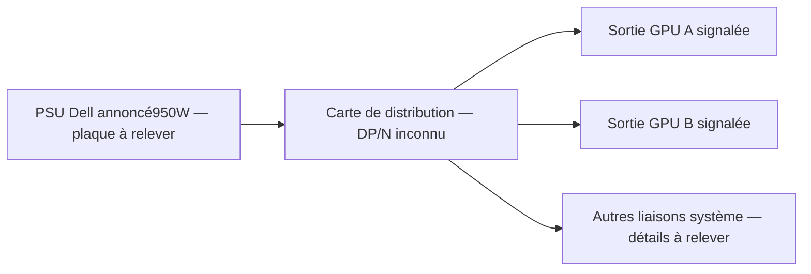
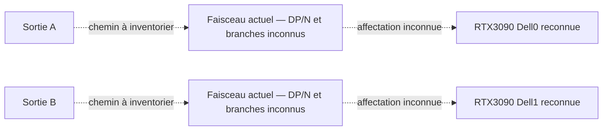
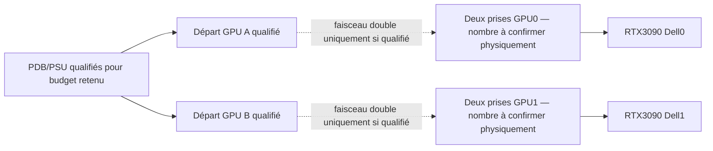

# Schémas fonctionnels — pas un brochage de raccordement

Les symboles A/B servent à repérer les deux sorties GPU signalées par le propriétaire. Ils ne sont ni des numéros de connecteurs Dell vérifiés ni une affectation de broches. La PDB réelle et ses références restent à observer.

## Distribution connue par déclaration

## Faisceaux existants

Ce dessin **ne prétend pas** que les cartes sont réellement raccordées chacune à une seule sortie. Leur reconnaissance est observée ; leur chemin électrique n’est pas encore décrit par le propriétaire.

## Cible fonctionnelle conditionnelle

Il s’agit du besoin fonctionnel étudié, **pas d’une instruction de branchement autorisée sur le matériel non identifié**. Le tableau constructeur distingue deux/quatre6+2 selon châssis ; il ne qualifie pas deux3090350W ni chaque départ PDB.

## Matrice électrique à renseigner sur preuve

| Départ / cavité vue face contacts et verrou défini | Destination / cavité |12V/masse/sense/NC | Preuve constructeur ou mesure hors tension | Courant admissible démontré |
| --- | --- | --- | --- | --- |
| A — non relevé | Non relevée | Inconnu | Absente | Inconnu |
| B — non relevé | Non relevée | Inconnu | Absente | Inconnu |

Aucune numérotation ou polarité n’est inventée. Une carte fonctionnelle en lecture NVIDIA ne remplit pas ce tableau.
