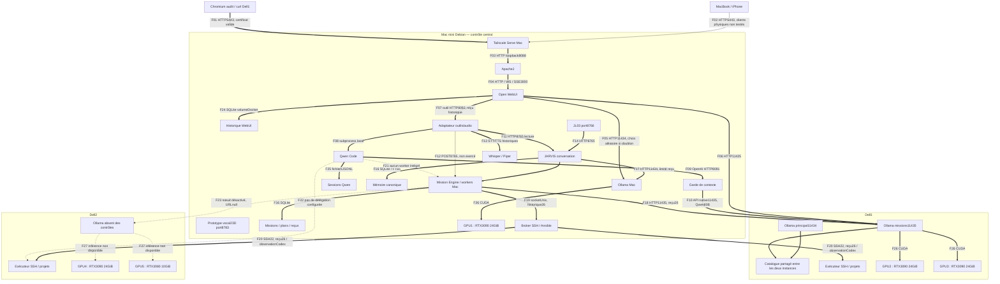

# Graphe observé

**Trait épais `==>` :validé**, avec preuve actuelle ou réception historique datée. **Trait fin `-->` :configuré, non reçu boutenbout.** **Pointillé `-.->` :absent ou envisagé.** Les référencesFxx renvoient à la matrice ;elles précisent protocole, port et portée de la preuve.

Les liens catalogue/Ollama sont des dépendances de stockage constatées, pas des copies de modèles entreAPI. Le graphe n'attribue ni80B niOllama àDell2. Les workersMac orchestrent des commandes surlesDell ;ils ne sont pas déplacés artificiellement surlesGPU.
