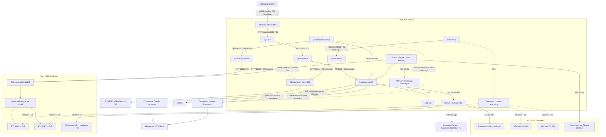

# Architecture observée et frontières

Trait continu : liaison testée, aujourd’hui ou historiquement selon Fxx. Pointillé : configuration ou réception incomplète. Croix : liaison absente. Les suffixes Fxx renvoient à interconnexions.csv ; un diagramme n’ajoute aucune réception.

Les cinq GPU sont représentés une seule fois. Le Dell 2 exécute des commandes mais n’est pas un serveur d’inférence. Le relais OAuth externe du connecteur Google échange/renouvelle les jetons : la connexion n’est pas intégralement hors ligne. La voie LiveKit est une chaîne vocale prototype reçue historiquement avec ses réserves ; elle ne crée pas une seconde mémoire canonique. Les liens MacBook/iPhone n’ont pas été retestés physiquement dans ce bilan.
