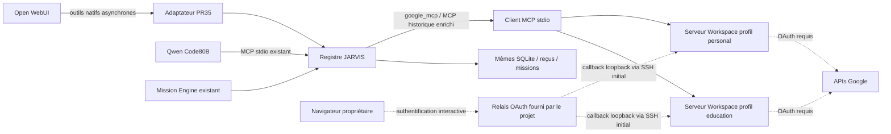

# Architecture installée et choix du connecteur

Le serveur source Google Workspace a été construit depuis son lockfile, sans lancer son script start qui réinstalle npm à chaque invocation. Les bundles sont installés sous /opt/jarvis/google-workspace-mcp ; des copies dans chaque profil privé fournissent l’ancrage de stockage attendu par le code amont. Aucun exécutable GeminiCLI, modèle, compte payant ou projetCloud n’a été installé/créé.

Les traits pointillés indiquent les accès dépendant d’une authentification non encore reçue, pas des flux fonctionnels prouvés. Le relais fournit l’échange de code et le renouvellement ; les refresh tokens lui sont transmis lors du renouvellement. Stockage local ne signifie pas absence de ce traitement chez le fournisseur.

Le fichier marker gemini-extension.json est distinct dans chaque profil. Stockage chiffré amont forcé par GEMINI_CLI_WORKSPACE_FORCE_FILE_STORAGE=true ; pas de keychain global partagé. Dossiers700 et clés locales600 vérifiés. Aucun HOME repointé. Un verrou par profil sérialise les opérations ; les deux comptes restent indépendants.

Le MCP historique conserve ses huit outils et ajoute google_mcp (neuf). Les six outils de transport client PR35 restent les mêmes ; leur façade peut désormais découvrir google_mcp. Aucun nouveau registre ou stockage de mission. Les reçus passent par Memory.audit et MissionStore existants.

Les outils d’envoi mail, suppression et révocation OAuth ne sont pas exposés dans ce profil de réception. Les chemins de téléchargement sont confinés aux espaces google-mcp/<profil>/downloads. Les écritures restent soumises à la promotion de mission du contrôleur existant. Un timeout retourne UNKNOWN et exige observation avant répétition.

Le composant legacy PR35 et son helper restent disponibles ; sans ancien jeton, son statut oriente vers le connecteur préféré, sans redemander un clientCloud. Aucune connexion historiquement validée n’a été supprimée.
