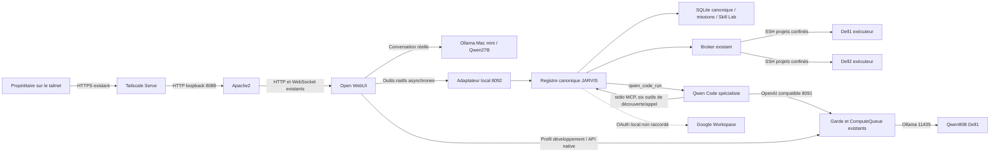

# Architecture installée

Le connecteur étend le registre JARVIS existant. Il utilise `runtime/memory.sqlite` pour les reçus clients, `runtime/missions.sqlite` pour les missions et le Skill Lab existant. Aucun second ordonnanceur ou stockage canonique de mémoire n’est créé. L’historique Open WebUI préexistant reste son historique d’interface ; sa mémoire intégrée est désactivée dans les profils livrés.

Les flèches pleines décrivent les parcours utilisés dans la campagne ; Google reste une dépendance d’authentification, sans réception distante. Dell2 est un exécuteur de commandes et tests : aucune inférence Ollama n’y est annoncée.

## Contrats

- `client_capabilities.py` : découverte paginée, schémas du registre actif, appel sous les autorisations existantes, reçus et consultation/création des missions canoniques.
- `client_mcp.py` : transport stdio compact pour Qwen Code. Le serveur MCP historique reste intact.
- `qwen_specialist.py` : délégation au spécialiste existant et lecture de son état. L’appel n’est pas une validation du code. Un conflit de concurrence signifie `NOT_EXECUTED` et demande l’observation du travail précédent.
- `google_workspace.py` : comptes OAuth distincts et opérations Workspace structurées. Le statut sans jeton est `AUTH_REQUIRED`. Aucun envoi Gmail n’est exposé dans cette livraison.
- Outils Open WebUI : les appels réseau sont exécutés par `asyncio.to_thread`, pour conserver la disponibilité de son serveur pendant une tâche longue.

Chaque appel conserve l’acteur déclencheur, les arguments, le résultat original et sa référence d’audit. Une projection courte est envoyée au modèle ; l’original reste lisible par pagination. Un identifiant réutilisé avec d’autres arguments est refusé. Si une réservation existe sans résultat, la réponse est `UNKNOWN` et ne redéclenche pas l’opération.

Les appels clients isolés ne sont pas présentés comme des missions autonomes reçues. Les missions durables restent sous le moteur existant et ses mécanismes P2/P3/P4. M26-P4 reste en pause.
