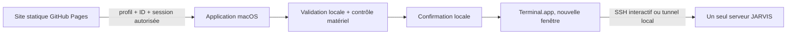

> **Copie documentaire Codex — mission 00.** Source réelle : `/home/adminjarvis/JARVIS-Launcher/docs/ARCHITECTURE.md`. Réception et preuves selon leur date, sans réexécution par cet audit. Le dépôt source et ses services restent inchangés. Données privées expurgées.

# Architecture et sécurité JL-01

Le navigateur conserve profil, favoris et session dans localStorage. Sur mobile ou hors macOS, il expose seulement les commandes à copier. Un iPad annonçant MacIntel mais disposant d’un écran tactile est traité comme mobile. Aucune bibliothèque distante, fonte CDN, analytics, backend public ou serveur HTTP local permanent.

L’application est compilée localement par osacompile depuis AppleScript. Le handler `open location` transmet l’URL à un script JXA installé dans les ressources via le quoting AppleScript `quoted form of`. Seules des ressources locales installées sont chargées comme code ; aucune chaîne venant du site ou de l’URL n’est évaluée comme JavaScript ou AppleScript.

`site/core.js` contient la politique commune, sans dépendance. La validation native s’applique indépendamment de la page : URL ASCII exacte, taille bornée, IDs connus, un seul argument `session` pour les deux actions tmux, session présente dans la configuration locale. Pourcentages, fragments, hôtes URL alternatifs, commandes, doublons de query et retours à la ligne sont refusés.

La configuration locale réside dans `~/Library/Application Support/JARVIS Launcher/config.json`, dossier 0700 et fichier 0600. Elle est créée à l’installation et conservée lors des mises à jour. Le site possède sa propre copie pour afficher/générer les secours. Modifier une configuration web ne modifie pas l’autorité locale ; les deux copies doivent être mises à jour volontairement. Les champs exécutables sont validés : utilisateur, hôte, chemin de clé, répertoire canonique et ports. Les labels UI sont insérés avec textContent.

Le profil URL doit correspondre au profil installé ET au matériel décrit par system_profiler. Seuls les noms matériel MacBook Pro et Mac mini sont acceptés ; un matériel inconnu est bloqué. Le contrôle ne transmet au site ni numéro de série ni nom du Mac. Il doit être testé réellement sur les deux clients avant réception complète.

Chaque action d’exécution demande une confirmation locale, car l’origine web d’un protocole personnalisé n’est pas authentifiable de façon fiable. Un site tiers peut demander une action connue ; il ne peut pas fournir de commande libre ou changer le serveur par query string. Le diagnostic `check` affiche uniquement une boîte locale, sans exécution SSH. Aucun résultat n’est renvoyé au site : la disponibilité affichée reste honnêtement non vérifiable.

SSH utilise le binaire natif, une clé existante, `-F /dev/null` pour éviter les alias/ProxyCommand implicites, un pseudo-terminal `-tt` pour les actions interactives, et un quoting POSIX de chaque argument et du script distant. Contrôle de clé d’hôte conservé, agent/X11 non transférés, délai de connexion borné. Aucun mot de passe, jeton ou contenu de clé dans les sources/URL. Une passphrase peut être saisie directement dans Terminal. Le chemin public d’une clé n’est pas la clé.

Les scripts distants sont construits depuis des modèles fermés ; aucun fichier JARVIS ne doit être installé sur les clients. Codex tourne dans le répertoire distant ; à son arrêt, un shell distant est conservé. tmux cible `=nom-exact`, teste l’existence avant attach, puis utilise `new-session -A` pour gérer la course avec une création concurrente. L’attachement n’utilise pas `-d`, ne détache pas les autres clients, ne supprime ni ne fusionne de session.

Le tunnel utilise `-N -L [ADRESSE EXPURGÉE]:PORT_LOCAL:[ADRESSE EXPURGÉE]:8765`, reste au premier plan et s’arrête avec Ctrl+C. Un port occupé fait échouer SSH via ExitOnForwardFailure ; ce drapeau ne vérifie pas la disponibilité du service web distant. Aucun navigateur n’est ouvert automatiquement avant vérification du tunnel. Le bouton LAN est un choix explicite, jamais un changement de cible automatique après échec.

Le lancement multiple est une liste fixe de trois actions (SSH, Codex tmux, tunnel), avec confirmations web puis locale. Les commandes ne ferment pas automatiquement Terminal à leur fin. Le lanceur ne limite pas les futures actions d’un utilisateur dans un shell/Codex interactif ; il borne uniquement ce que peut demander le site.
