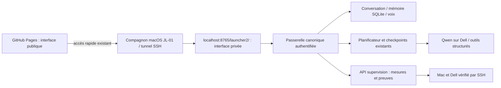

> **Copie documentaire Codex — mission 00.** Source réelle : `/var/lib/jarvis/projects/JARVIS-Launcher2/docs/ARCHITECTURE.md`. Réception et preuves selon leur date, sans réexécution par cet audit. Le dépôt source et ses services restent inchangés. Données privées expurgées.

# Architecture JL-02

Les sources statiques sont identiques pour GitHub Pages et l’interface privée. Sur Pages, les données sont indisponibles et le bouton de connexion ouvre l’espace local via le tunnel. Les API et le cookie restent de même origine sur localhost ; aucun CORS vers le laboratoire, aucun jeton permanent dans le navigateur public. Le cookie existant reste HttpOnly/SameSite=Strict et expire selon Auth ; logout le révoque côté serveur.

## Contrats privés

- `GET /api/launcher/resources` : mesures CPU, RAM, GPU, VRAM, température, Ollama, modèles chargés, disponibilité et date d’échantillonnage. Mesures en cache rafraîchies automatiquement. Dell 2 reste explicitement indisponible.
- `GET /api/launcher/missions` : états persistants, tâches et preuves, agents JARVIS/Codex séparés. Un pourcentage par tâches est distinct d’une progression mesurée ou estimée.
- `GET /api/launcher/events?mission=ID&after=N` : lecture incrémentale des checkpoints existants, corrélation aux traces réelles quand disponibles, commandes, sorties, codes et références de preuve. Sorties bornées, aucun état réussi inventé.
- `GET /api/launcher/artifact?path=...` : fichiers textuels des seuls projets autorisés, taille limitée ; refus des chemins privés, .git, .ssh et des sorties de racine.
- `/api/chat`, `/api/stt`, `/api/tts`, `/api/missions`, `/api/missions/resume` : API canonique réutilisée.
- `POST /api/missions/interrupt` : interruption coopérative. Une commande engagée peut se terminer ; aucun nouvel outil n’est lancé après constat de l’interruption. Reprise depuis les checkpoints, sans garantie exactly-once.

La mémoire personnelle canonique conserve son schéma. La seule table supplémentaire, `launcher_operator_tasks`, conserve les jalons Codex distincts ; elle ne remplace pas les missions/checkpoints JARVIS et n’est pas une base de souvenirs concurrente. Ses preuves sont consignées par l’opérateur, pas déduites de phrases du modèle.

## Héritage

Les profils Mac désignent les clients. Les actions SSH/Codex/tmux/tunnel/services utilisent `core.js` et le protocole du compagnon JL-01, copiés sans modification. Leurs contrôles natifs demeurent ; JL-02 n’ajoute pas de validation humaine à l’exécution des missions autorisées. Le lien Open WebUI dépend de son tunnel local sur le port 3000 ; il ne prétend pas le créer via le tunnel conversation 8765.
