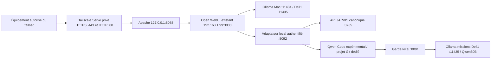

# Architecture installée — 29 octobre 2026

Apache est un reverse proxy, pas le serveur applicatif Python. Il écoute seulement sur loopback. Tailscale publie ce listener dans le tailnet, sans Funnel. Les connexions WebSocket sont transférées par `proxy_http`/`upgrade=websocket`; le streaming SSE est conservé. HTTPS est reçu après activation extérieure : HTTP200/TLS0 sur Mac et Dell1, Chromium en contexte sécurisé avec contrôle normal du certificat. Les preuves sont dans HTTPS-RECEPTION.json ; l'ancien blocage est conservé dans l'instantané initial du rapport.

Open WebUI conserve son conteneur, son image épinglée et le volume `jarvis-open-webui-data`. Le fragment de configuration complète le compose existant. Les API de modèles comprennent le Mac et le service de missions Dell1 déjà déployé sur11435. Le service historique11434 du Dell n'est pas arrêté. La première tentative Qwen Code l'avait sollicité et créé un runner CPU4096 inutile : cette tentative est conservée, interrompue, puis seule sa résidence est libérée après arrêt.

Qwen Code0.26.4 utilise Node22.23.4 dans un préfixe séparé. Node20.19.2 système reste inchangé. Les commandes sont exécutées sur le Mac dans un **projet expérimental dédié** : ceci répond à cette mission d'installation Mac, sans prouver une délégation aux deux Dell ni remplacer le moteur distribué. L'inférence80B est réellement sur Dell1. Le profil `qwen-local` refuse de démarrer en dehors de `qwen-code-projects/` ; ce contrôle du point d'entrée n'est pas un confinement système de chaque commande shell.

Le garde traduit les appels OpenAI compatibles vers `/api/chat` natif : cette traduction est nécessaire pour imposer `num_ctx=32768`, indisponible comme paramètre sur l'endpoint OpenAI d'Ollama observé. Réponse limitée à4096tokens ; entrée refusée avant inférence au-delà de27648octets, borne conservatrice distincte d'un comptage exact en tokens. Aucun texte n'est tronqué silencieusement. Les outils implicites volumineux de Qwen Code sont exclus via son mode `--bare`. Les reçus conservent tailles et comptages réellement retournés.

L'adaptateur n'a ni ordonnanceur de missions ni deuxième base de mémoire. Trois outils Open WebUI consultent les missions, soumettent un nouvel objectif au moteur existant ou exécutent un spécialiste Qwen Code borné. Un seul appel spécialiste à la fois ;12tours,12appels d'outils et10minutes maximum. Ces limites ne constituent pas la réception du compteur sémantique des trois corrections de M26. Un appel réseau dont le résultat est perdu ne doit pas être rejoué aveuglément : consulter ses reçus privés.

Les endpoints audio compatibles OpenAI réutilisent Whisper et Piper via JARVIS. L'adaptateur comprend les envois multipart chunked d'Open WebUI. Les comptes rendus d'essai distinguent le WAV fourni par Piper et la conversion MP3 effectivement renvoyée par Open WebUI.

L'accès aux outils/audio exige une clé Bearer privée, stockée dans les valves et l'environnement local ; aucun secret dans Git. Les anciens identifiants en clair JARVIS ne correspondent plus au hash actif. Une session de service locale est donc provisionnée dans la table **existante** `auth_sessions`, avec expiration8h et renouvellement à authentification expirée. Ni mot de passe ni utilisateur propriétaire n'est changé. Cette intégration locale dispose des droits du compte JARVIS existant ; ce n'est pas une API multi-utilisateurs à délégation fine.

La mémoire canonique reste SQLite/FTS5 JARVIS. Open WebUI conserve son historique propre de présentation ; le profil expérimental n'active pas son outil de mémoire. Les missions restent dans le moteur JARVIS. M26-P4 et son superviseur restent explicitement en pause.
