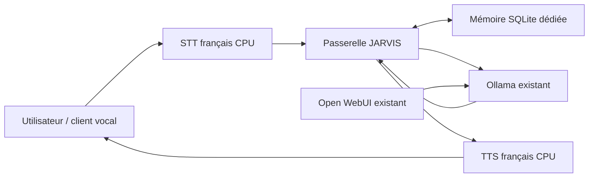

> **Reprise documentaire par Codex — mission 00, 17 octobre 2026.** Source locale JARVIS : `/home/adminjarvis/JARVIS/rapports/mission11.md`. Texte historique expurgé ; les restrictions et états anciens sont datés. Le [registre courant](../../00-Mission-Pilotage-point-26-10-17/REGISTRE-MISSIONS.md) prévaut pour la consolidation. Les liens vers des preuves privées non publiées restent des références historiques ; leur contenu n’est pas prétendument récupéré.

# JARVIS — Mission 11 : audit de Jarvis Voice et préparation de l’intégration

12 octobre 2026 — étude statique, sans installation ni exécution du code téléchargé.

## 1. Résumé exécutif

**Décision recommandée : NO-GO pour intégrer intégralement Jarvis Voice en l’état ; GO sous conditions pour l’option B, modulaire.** Une réutilisation ciblée est envisageable, mais son gain de temps doit être démontré avant adoption.

Le candidat le plus proche du besoin est **[bigsk1/jarvis-voice](https://github.com/bigsk1/jarvis-voice)** : voix, interface Web, Ollama, outils et mémoire structurée sont présents dans le code. L’identité du projet initial reste **EN ATTENTE**, car aucune URL ni auteur n’était fourni. Les conclusions détaillées concernent ce candidat, pas tous les logiciels appelés Jarvis.

Il ne constitue pas une extension prête à brancher sur notre Open WebUI. Il apporte son propre environnement Python, ses interfaces, bases et services. Sa licence est restrictive, ses valeurs par défaut sont anglaises, son système d’embeddings impose un modèle supplémentaire et ses protections varient selon le canal d’exécution. Le contrôle vocal d’actions sensibles n’est pas acceptable en l’état. La mention « Production Ready » du README n’est pas une validation pour notre machine.

**Chemin le plus rapide :** une interface vocale française indépendante, appui pour parler, faster-whisper multilingue sur CPU, Piper français sur CPU, appel de l’API Ollama existante et petite mémoire SQLite dédiée. Open WebUI, ses conversations, son volume et les modèles restent intégralement conservés. Une intégration ultérieure dans Open WebUI pourra utiliser ses interfaces audio, mais demandera une autorisation distincte pour ses réglages applicatifs.

La mémoire minimale doit conserver des faits et préférences explicitement approuvés, avec source, correction et suppression. Aucun réentraînement de Qwen n’est nécessaire. L’apprentissage automatique fiable des habitudes est un chantier ultérieur.

## 2. Identification et périmètre des dépôts

| Candidat | Auteur / dépôt exact | Différence déterminante | Traitement |
|---|---|---|---|
| Jarvis Voice principal | BigSk1 — [bigsk1/jarvis-voice](https://github.com/bigsk1/jarvis-voice) | Assistant complet Python/Web, Ollama, mémoire, outils | Inspection statique approfondie ciblée |
| Jarvis Voice dictée | Sp33dyFoX — [Sp33dyFoX/jarvis-voice](https://github.com/Sp33dyFoX/jarvis-voice) | Dictée locale vers Claude Code via openWakeWord/faster-whisper ; pas l’assistant complet recherché | README, licence et métadonnées ; fonctions internes non auditées |
| Jarvis Voice TUI | strognoff — [strognoff/jarvis-voice](https://github.com/strognoff/jarvis-voice) | Android/Termux, passerelle OpenClaw, STT/TTS Termux | Documentation et métadonnées ; inadapté directement à Debian |
| JARVIS Rust | Priler — [Priler/jarvis](https://github.com/Priler/jarvis) | Assistant hors ligne Rust annoncé WIP, README signalé obsolète | Métadonnées seulement ; pas assimilé à bigsk1 |

Aucune référence à une URL Jarvis Voice n’a été retrouvée dans les rapports 06 à 10 consultés. Ces candidats sont plausibles, non une liste exhaustive. Le candidat bigsk1 correspond au nom exact et aux capacités demandées ; cette correspondance reste une hypothèse explicitement signalée.

## 3. Maintenance, licence, technologies et installation

### État daté

Snapshot bigsk1 examiné : **v2.56.0**, commit **`68cfe48d3ae775dd56d4ef0e7bd69843b346b228`**, daté du **12 octobre 2026 à 13:51:47 UTC**. Le dernier commit concerne les diagrammes, mais les commits précédents du même jour modifient aussi les tâches planifiées et l’inbox. Métadonnées GitHub : dépôt créé le 11 novembre 2025, non archivé, dernier push le 12 octobre 2026 à 13:52:35 UTC ; 8 étoiles, 1 fork, zéro issue ouverte au relevé. La première page des contributeurs n’en renvoie qu’un. Activité récente réelle, faible diversification de maintenance ; zéro issue n’est pas une preuve d’absence de bugs. Voir activité (référence locale historique non publiée), métadonnées (référence locale historique non publiée) et maintenance (référence locale historique non publiée).

Sp33dyFoX : dernier push le 24 juin 2026 ; strognoff : 8 mai 2026 ; Priler : 18 février 2026. La date `updated_at` peut refléter des changements sans contribution au code ; elle n’est pas utilisée comme dernière contribution.

### Licence

Le fichier [LICENSE au commit audité](https://github.com/bigsk1/jarvis-voice/blob/68cfe48d3ae775dd56d4ef0e7bd69843b346b228/LICENSE) accorde l’usage personnel et la modification, exige attribution et conservation de la licence, et soumet l’usage commercial à une permission écrite. C’est une licence personnalisée **source available**, pas une licence libre sans restriction commerciale. Réutiliser un module copie aussi ses contraintes. Usage personnel envisageable ; usage professionnel/commercial **EN ATTENTE** de qualification et, si applicable, de permission. Ce constat résulte du texte publié, sans interprétation juridique exhaustive.

Sp33dyFoX utilise PolyForm Noncommercial 1.0.0. strognoff annonce MIT dans son README, mais GitHub ne reconnaît pas de licence et le fichier LICENSE à la racine renvoie 404 : **licence effective non vérifiée**. La licence de Priler n’a pas été qualifiée au-delà des métadonnées `Other`.

### Technologies et dépendances

Python **≥3.12**, scripts Bash, SQLite/FTS5, FastAPI/Uvicorn, Flask/Socket.IO, JavaScript navigateur ; clients de fournisseurs LLM dont Ollama. STT faster-whisper **1.2.0**, CTranslate2 **4.6.0**, PyAV, openWakeWord, ONNX Runtime, sounddevice ; traitement audio SoX/FFmpeg/ALSA. TTS local via serveurs externes Kokoro ou Qwen3-TTS. Nombreuses autres dépendances : SDK cloud, Docker, PDF, Paramiko, outils Web et multimédia. `pyproject.toml` et `uv.lock` sont archivés ; aucune résolution ni installation n’a été exécutée.

Documentation abondante : INSTALL_GUIDE, QUICKSTART, MEMORY_SYSTEM, USER_PROFILE_SYSTEM, WEB_TALK, SYNC_ARCHITECTURE, SECURITY_HARDENING et documentation Ollama. Présence de 489 fichiers sous `tests` au relevé ; ni leur succès ni leur couverture réelle ne sont établis. Les documents d’archive ne sont pas traités comme implémentation actuelle.

Procédure officielle étudiée : clone dans `~/jarvis-voice`, `install.sh`, dépendances système, environnement partagé `~/jarvis-venv` via uv/lockfile, initialisation et vérification ; réglage de `config/local.env`, lancement local, services optionnels. L’installateur peut appeler sudo/APT, télécharger puis exécuter l’installateur uv et appeler setup. **Ne pas employer cette procédure sur JARVIS sans mission d’intégration explicitement autorisée.** Dans cette étude elle a seulement été lue.

## 4. Tableau des fonctionnalités du candidat bigsk1

« Native et documentée » signifie documentation et chemin de code identifiés, **pas test fonctionnel sur notre machine**. « Possible avec adaptation » inclut configuration, ajout de service ou modification nécessaire. Les preuves correspondent au commit figé ; index détaillé (référence locale historique non publiée).

| Fonction | Classement | Preuve et limite |
|---|---|---|
| 1. STT français | **Possible avec adaptation** | `bin/stt.py` appelle WhisperModel avec détection de langue ; défaut `small.en` incompatible avec l’objectif. Choisir `small` multilingue, idéalement exposer `language="fr"`. Qualité française non testée. |
| 2. TTS français | **Possible avec adaptation** | `say-local.sh` appelle Kokoro ou Qwen3-TTS externes. Voix anglaise par défaut. Serveur Kokoro et voix française à configurer ; le français est documenté chez le fournisseur. Piper n’est pas un backend local actif de ce script. |
| 3. Dialogue alterné | **Native et documentée** | Chaîne micro → STT → orchestrateur → TTS ; `question-orchestrator-local.sh`, Web Talk et `talk.js`. Flux implémenté ; acoustique et latence non mesurées. |
| 4. Navigateur/appareil distant | **Native et documentée** | `getUserMedia`, MediaRecorder, états Talk, transcription et lecture audio ; micro du client. HTTPS/localhost et authentification nécessaires. |
| 5. Ollama | **Native et documentée** | `OllamaProvider` dans `llm_provider.py`, appels `/api/chat`, URL et modèle configurables. Version locale exacte non testée avec ce logiciel. |
| 6. Open WebUI | **Possible avec adaptation** | Documentation d’un endpoint Qwen3-TTS utilisable par Open WebUI. **Pas de connecteur trouvé partageant les chats, profils, utilisateurs ou mémoire d’Open WebUI avec l’assistant complet.** Coexistence possible. |
| 7. Mémoire entre conversations | **Native et documentée** | SQLite `conversations`, `knowledge_base`, récupération et injection ; persistance indépendante des processus. |
| 8. Préférences/habitudes | **Native et documentée pour les mécanismes ; efficacité des habitudes non vérifiée** | Préférences structurées, `user_model` avec confiance/preuves, profil Markdown et hooks d’intelligence. Ce n’est pas la démonstration d’un apprentissage fiable de routines personnelles françaises. |
| 9. Connaissances documentaires | **Native et documentée** | Source Library : originaux, extraction de passages, FTS, vecteurs et recherche. Les embeddings de sélection d’outils ne sont pas confondus avec le RAG documentaire. |
| 10. Outils/automatisations | **Native et documentée** | Registre et `orchestrator/executor.py`, scripts, workflows, tâches. Les « 200+ » annoncés ne sont pas tous audités ; dépendances externes fréquentes. |
| 11. Restrictions sensibles | **Native et documentée, mais insuffisante globalement** | Allowlist/exclusions et approbation Web existent. Dans `executor.py:509`, contrôle vocal annoncé puis poursuite ; TODO de confirmation verbale. **Blocage uniforme non vérifié, NO-GO pour outils sensibles.** |
| 12. Plusieurs serveurs/modèles | **Possible avec adaptation** | `ollama_utils.py` gère plusieurs URLs et bascule ; modèles configurables. Pas de preuve d’ordonnancement distribué, mémoire répliquée ou coordination multi-modèle répondant à notre cible. |

## 5. Compatibilité avec notre installation

### Debian, isolation et réseau

Python local **3.13.5** satisfait le minimum déclaré. Cela ne prouve pas que toutes les roues binaires du lockfile sont compatibles avec Debian 13/Python 3.13. L’installation est orientée Ubuntu 24.04+, le script système accepte Debian via `/etc/debian_version`. SoX/FFmpeg/ALSA et périphériques audio devront être qualifiés ; aucune particularité T2Linux n’est traitée dans le projet. Le microphone du navigateur évite de dépendre du micro interne du Mac, mais pas de la capture sur le client.

Petit inventaire dpkg en lecture seule : Docker et libsndfile1 ont une version ; SoX n’est pas trouvé ; ffmpeg, libportaudio2 et python3-venv ne renvoient pas de version dans ce relevé. Leur disponibilité opérationnelle ne doit pas être supposée. Aucun paquet ajouté.

Ports existants observés : Ollama boucle locale **11434**, Open WebUI LAN **3000**, SSH et CUPS. Ports proposés par bigsk1 : API **8880**, Web **5001**, mémoire **5002**, intelligence **5003**, docs **5004**, Canvas **8890**, Qwen3-TTS **8881**. Aucun de ces ports additionnels n’était observé en écoute. **Conflit entre exemples : Kokoro local.env vise aussi localhost:8880, occupé par l’API Jarvis si tous deux sont sur l’hôte.** Réserver par exemple un port distinct pour TTS lors d’une future mission ; ports proposés, jamais ouverts ici.

Le Compose amont utilise un réseau bridge `jarvis-net`. Notre Docker a `bridge=none`, `iptables=false`, `ip-forward=false` selon Mission 06. Ne pas présumer son déploiement bridge fonctionnel. Surtout, `host.docker.internal` ne rend pas accessible un Ollama lié exclusivement à [ADRESSE PRIVÉE EXPURGÉE] depuis un bridge. **Choix futur :** service utilisateur isolé sur l’hôte ; ou conteneur en réseau hôte avec écoute applicative explicitement locale, sans modifier Docker/Ollama. Le réseau hôte réduit l’isolation réseau. Aucun montage du socket Docker, des unités système ou du volume WebUI n’est nécessaire à la voix minimale.

### Ollama, Qwen et Open WebUI

GET `/api/version` confirme **0.40.3** ; GET `/api/tags` confirme `qwen3.5:27b-q4_K_M`, `ministral-3:14b-instruct-2512-q4_K_M`, `llama3.1:8b`. Aucune génération, aucun changement de modèle effectué. Le chemin chat bigsk1 emploie `/api/chat`, `options`, `think`, sorties structurées et appels d’outils. Le chemin embeddings utilise `/api/embed` avec contrat de dimension/digest. Le chat basique est plausible ; **aucune garantie de compatibilité totale de ces options avec cette version** sans essais autorisés. Ne pas prévoir de mise à jour Ollama comme prérequis implicite.

Qwen 3.5 27B est déjà qualifié dans Mission 10 : 65/65 couches GPU, contexte 8192, VRAM maximale 17 489 Mio / 24 576 Mio, environ 38 tokens/s ; réponses longues de 55–61 secondes sur les essais documentés. Ce débit n’est pas un délai de réponse vocale. Le profil qualité et ses instructions existent dans Open WebUI : **un appel direct à Ollama ne les récupère pas automatiquement**. Prévoir une instruction JARVIS propre à la nouvelle passerelle, versionnée, en français, budget court et séparation de `message.content`/`thinking`. Ne jamais lire oralement le raisonnement interne.

Open WebUI **v0.12.0** offre déjà dans son code des endpoints STT/TTS et des routes mémoire authentifiées : [audio](https://github.com/open-webui/open-webui/blob/v0.12.0/backend/open_webui/routers/audio/__init__.py), [mémoire](https://github.com/open-webui/open-webui/blob/v0.12.0/backend/open_webui/routers/memories.py). Les capacités audio peuvent donc être exploitées ultérieurement sans Jarvis Voice complet. Leur activation effective, modèles disponibles et fonctionnement navigateur ne sont pas vérifiés ici. Une mémoire WebUI existe, mais sa disponibilité ne démontre pas l’apprentissage automatique d’habitudes.

Préservation des conversations : pas de migration, export privé ou accès SQL direct dans cette mission. À terme, conserver la base active dans son format WebUI et accéder aux fonctions requises par API/interface documentée, jamais par écritures directes dans webui.db. Une interface indépendante conserve les anciens chats accessibles dans WebUI, mais crée ses propres nouveaux échanges ; elle ne constitue pas immédiatement un historique unifié. Si l’historique unique est exigé, privilégier une étape d’intégration WebUI après preuve vocale, avec sauvegarde et autorisation applicative.

### CPU, GPU, RAM et stockage

**Choix initial CPU pour STT/TTS, RTX 3090 réservée à Ollama.** La marge arithmétique du pic Mission 10 est de **7 087 Mio, soit environ 6,9 Gio** ; ce n’est pas une réservation garantie. Le contexte, les caches et les charges concurrentes peuvent la réduire. faster-whisper GPU exige aussi cuBLAS CUDA 12 et cuDNN 9 : CUDA opérationnel pour Ollama ne démontre pas la présence de ces bibliothèques. Aucun changement pilote/CUDA proposé pour le MVP.

Le benchmark amont de faster-whisper `small` CPU int8 donne environ 1,5 Go RAM sur un autre processeur ; ne pas extrapoler sa vitesse au Mac 2018. Estimation de provisionnement à vérifier : **2–4 Gio RAM additionnels et 2–5 Go de disque** pour STT multilingue, voix Piper, environnement et passerelle minimale, hors archives audio. Pour l’ensemble bigsk1 : enveloppe prudente **5–15 Go disque hors modèles/archives et 4–8 Gio RAM hors LLM**, estimation d’ingénierie, pas minimum officiel ni mesure. Les serveurs TTS, modèles auxiliaires et index peuvent largement dépasser cette enveloppe.

Relevé local : environ **31,2 Gio RAM totale**, **28 Gio disponibles**, **355 Go disque disponibles**, sans swap utilisé à cet instant. Les archives audio peuvent croître sans limite ; définir rétention et quotas. `/tmp` est en tmpfs : le clone d’audit occupe de la RAM et reste petit ; aucun modèle vocal téléchargé.

La configuration bigsk1 suggère des modèles distincts pour statut, feedback, construction d’outils, helper et embeddings. Aucun des modèles vocaux/embedding nécessaires n’est actuellement garanti présent. Avec `OLLAMA_MAX_LOADED_MODELS=1` documenté en Mission 08, charger les embeddings ou auxiliaires peut évincer Qwen, même si ceux-ci emploient le CPU. Désactiver ces fonctions dans le MVP ; commencer avec FTS5 sans embeddings. Les performances CPU, latence TTS et stabilité thermique restent à mesurer lors d’une mission autorisée.

## 6. Analyse des modules vocaux

**STT.** `bin/stt.py` charge WhisperModel lors de chaque invocation, CPU/int8 par défaut, VAD et silence de 300 ms ; aucun paramètre de langue explicite dans ce chemin. Passer de `small.en` à `small` multilingue est indispensable. Un service STT résident évite les chargements à chaque tour. Évaluer ensuite `base` si la latence CPU de `small` est excessive, sur les mêmes phrases françaises. Whisper classique est possible, mais faster-whisper réduit les dépendances et dispose d’un chemin CPU quantifié documenté. Le décodage PyAV peut éviter un FFmpeg système pour ce module ; les scripts audio du projet complet en ont néanmoins besoin. [faster-whisper officiel](https://github.com/SYSTRAN/faster-whisper).

**TTS.** Jarvis Voice contient des clients HTTP, pas le moteur local complet. Kokoro-FastAPI dispose d’un mode CPU et supporte le français ; une voix française telle que `ff_siwis` est documentée. Il faut qualifier le serveur et le format réellement envoyé par le client, qui n’envoie pas ici de langue explicite. Qwen3-TTS est distinct du modèle conversationnel Qwen 3.5 : ajouter cette synthèse ne réutilise pas simplement ses poids. Elle est plus ambitieuse et non prioritaire pour préserver la VRAM. [Kokoro-FastAPI](https://github.com/remsky/Kokoro-FastAPI), [voix Kokoro](https://huggingface.co/hexgrad/Kokoro-82M/blob/main/VOICES.md).

**Piper recommandé pour la première version.** Moteur local maintenu dans [OHF-Voice/piper1-gpl](https://github.com/OHF-Voice/piper1-gpl), GPL-3.0 ; voix française `fr_FR-siwis-medium`, modèle ONNX et configuration associée. La carte Siwis indique un corpus CC-BY 4.0 : vérifier aussi les conditions du modèle choisi avant redistribution ; ne pas attribuer automatiquement la licence globale du dépôt à toutes les voix. Nécessite un petit adaptateur API si branché à Open WebUI. [Carte française Siwis](https://huggingface.co/rhasspy/piper-voices/blob/main/fr/fr_FR/siwis/medium/MODEL_CARD).

**Dialogue et client distant.** Web Talk est réellement implémenté, avec états écouter/transcrire/travailler/parler, suspension du micro et boutons d’interruption. Des phrases de contrôle sont anglaises ; les traduire fait partie de l’adaptation. Pour le MVP, alternance stricte avec appui pour parler, micro coupé pendant la réponse, pas de wake word ni interruption automatique. Un navigateur distant nécessite un contexte sécurisé HTTPS : notre accès WebUI HTTP LAN ne suffit généralement pas à autoriser `getUserMedia`. Préparer une origine HTTPS indépendante et authentifiée dans une future mission réseau autorisée, ou débuter sur localhost. [Exigences navigateur MDN](https://developer.mozilla.org/en-US/docs/Web/API/MediaDevices/getUserMedia).

## 7. Analyse de la mémoire

| Besoin | Ce qui est implémenté | Limite pour JARVIS |
|---|---|---|
| Historique | SQLite `conversations`, session, requête/réponse/outils | Historique bigsk1 distinct du WebUI existant |
| Long terme | `knowledge_base`, importance, source, metadata, embeddings, FTS, injection | Sélection et exactitude non garanties |
| Préférences | Catégories et clés, normalisation, expiration, `set_preference`, profil Markdown | Politique de consentement JARVIS à établir |
| Habitudes | `user_model` avec confiance/preuves ; couche Intelligence et feedback | Pas de validation d’inférence fiable de routines utilisateur |
| Projets | Faits catégorisés, documents et contexte | Pas de séparation robuste par projet démontrée dans cet audit ; ajouter project_id/ACL |
| Documents | Source Library : originaux/passages/FTS/vecteurs | Index WebUI non repris automatiquement ; OCR/service éventuel supplémentaire |
| Correction/suppression | `update_memory(id)`, `forget(id)`, routes mémoire, suppression sources | Effacement d’un fait ne prouve pas purge des conversations, sauvegardes ou leçons dérivées |
| Indépendance du modèle | Faits et historique en SQLite, profil externe | Embeddings liés au modèle/digest ; réindexation lors d’un changement |
| Partage Mac/Dell | URLs Ollama multiples, sync cloud/local sur disque | Pas de réplication distribuée validée ; serveur mémoire central à développer |

Le code `memory_db.py` crée réellement les tables et implémente recherche/correction/suppression. `orchestrator_v2.py` prépare l’injection automatique ; `response_formatter.py` ajoute la carte utilisateur. Il existe donc une mémoire personnelle structurée, distincte de la simple conservation d’échanges. **La présence d’un score de confiance ou d’un évaluateur LLM ne garantit pas que les habitudes apprises soient vraies.** Les règles FTS `porter unicode61` emploient un stemming anglais ; la recherche française mérite une stratégie testée, par exemple unicode61 et clés structurées.

Les embeddings bigsk1 ont un contrat précis de modèle/digest/dimension 768 et d’entrées. Remplacer ce moteur par un embedding quelconque n’est pas une simple substitution de nom. Une extraction de `memory_db.py` entraîne ses imports et conventions de configuration ; ce fichier n’est pas un composant autonome immédiatement réutilisable.

Le sync amont copie faits, traits et les **100 échanges récents** entre bases cloud/local et régénère les vecteurs. Il ne synchronise pas toute la vie applicative ni les tâches planifiées. Ce mécanisme ne doit pas être utilisé comme preuve de partage Mac/Dell. Préférer une API mémoire unique sur le Mac, Dell client de cette API ; éviter un fichier SQLite ouvert en écriture sur un partage réseau.

**Mémoire complémentaire minimale recommandée :** SQLite dédiée, table de faits `(id, user_id, project_id, key, value, source, created_at, updated_at, status)`, historique séparé, recherche FTS, API CRUD avec contrôle utilisateur, exports portables. Au départ, enregistrer seulement après demande explicite « retiens… » et afficher la formulation retenue. Une correction remplace la valeur active et invalide les index/caches ; une suppression retire le fait actif et définit le traitement des copies dérivées et sauvegardes. Historique brut, fait validé et hypothèse d’habitude doivent être distincts. Aucune donnée réelle utilisée pour l’étude.

Ensuite : propositions de faits à confirmer, détection des contradictions, provenance, durée de validité, classement par projet, retrieval sémantique français sur CPU, documents avec références, export/import et chiffrement des sauvegardes. Les poids du modèle restent inchangés ; le modèle reçoit à chaque tour les souvenirs pertinents sélectionnés par la passerelle.

## 8. Comparaison des architectures

| Critère | A — ensemble Jarvis Voice | B — composants séparés | Hybride — sélection de modules/concepts |
|---|---|---|---|
| Compatibilité | Plausible, adaptations multiples et API exacte à tester | Bon alignement avec services actuels | Dépend des dépendances extraites |
| Effort première version | 5–10 jours ouvrés, hors surprise | 2–4 jours ouvrés pour MVP local | 3–6 jours ; gain non démontré |
| Maintenance | Fork volumineux et dépendance au mainteneur | Petite passerelle, contrats explicites | Double suivi amont/code extrait |
| Fiabilité | Nombreux chemins/outils ; validation locale absente | Périmètre réduit, pannes isolables | Variable selon périmètre |
| Modularité | Services distincts mais conventions/imports couplés | STT/TTS/mémoire/LLM remplaçables | Bonne si interfaces redéfinies |
| Performances | Helpers, feedback et embeddings peuvent multiplier les appels | Un appel chat par tour, voix CPU résidente | Acceptable sans surcharge d’orchestration |
| Réversibilité | Bonne seulement dans installation entièrement séparée | Arrêt/retrait des ajouts dédiés | Bonne si aucune migration active |
| Données | Mode local à configurer intégralement, outils externes nombreux | Local par défaut, flux minimaux | Licence et télémétrie/destinations à contrôler |
| Plusieurs serveurs | URLs et failover existants ; coordination à construire | Passerelle + API mémoire centrale adaptées à la cible | Utilitaires de routage éventuellement utiles |
| Une identité JARVIS | Nouvelle UI et mémoire séparées de WebUI | Identité/prompt/mémoire centralisés ; historique unique à intégrer ensuite | Nécessite un propriétaire clair du contexte |

Estimations d’ingénierie pour un développeur connaissant l’installation, **pas un devis ni des durées mesurées**. Un jour représente 6–8 heures utiles. HTTPS distant et validation opérationnelle peuvent ajouter 0,5–1,5 jour. L’inférence des habitudes et le RAG approfondi demandent des missions distinctes.

**Hybride tangible :** reprendre les idées d’états Talk, IDs explicites de mémoire, provenance et portabilité ; éventuellement une extraction étroite après vérification de licence et mesure du couplage. Réutiliser directement les moteurs indépendants faster-whisper/Piper ne nécessite pas de reprendre Jarvis Voice. Copier son orchestrateur complet pour un simple dialogue n’apporte pas de gain établi. Réutiliser Kokoro seul à la place de Piper peut être utile pour une voix plus expressive, à comparer sur CPU après le MVP.

## 9. Efforts et première version opérationnelle

La première version recommandée utilise un petit client dédié avec le même nom JARVIS et une passerelle locale :

Ce schéma décrit une proposition, aucun composant n’a été déployé. Les échanges vocaux ne sont pas automatiquement des chats WebUI. La mémoire peut être indépendante du modèle dès cette première version ; son raccordement à l’interface WebUI demandera une mission applicative supplémentaire.

Rapidement réalisable après autorisation : choix STT multilingue, synthèse Piper, appel du modèle exact, dialogue alterné, faits explicites persistants, petite interface locale. À repousser : écoute permanente, reconnaissance du locuteur, interruption vocale, habitudes implicites, actions système, réplication, orchestration multi-serveur, long contexte et modèles vocaux GPU.

Budget de réponse orale court : commencer avec Llama existant pour la latence, offrir Qwen/Ministral au choix et mesurer les trois sans modifier leurs poids. Conserver les paramètres existants des profils WebUI ; la passerelle définit ses propres options par requête. Pour Qwen, qualifier le raisonnement et le budget au lieu de supposer que `think=false` sera honoré partout.

## 10. Recommandation motivée et conditions

- **A complet : NO-GO en l’état.** Français non prêt par défaut, licence restrictive, couche applicative concurrente, dépendances et modèles auxiliaires, protections vocales insuffisantes, aucune compatibilité exécutée sur Debian/Ollama exacts.
- **B modulaire : GO sous conditions.** Autoriser une prochaine mission limitée aux nouveaux composants, conserver tous les services existants, voix CPU initiale, mémoire séparée et aucune capacité de commande système. Choisir HTTPS seulement dans un périmètre ultérieur explicitement autorisé si nécessaire.
- **Hybride : GO sous conditions pour une étude/extraction étroite**, si licence applicable compatible et réduction de temps prouvée. Pas de reprise automatique du projet complet.

Les restrictions des Missions 08/10 demeurent : les modèles ne sont pas des administrateurs autonomes fiables. Pour le MVP, l’unique écriture autorisée à la passerelle sera sa mémoire personnelle explicitement demandée ; le modèle ne disposera d’aucun shell, sudo, SSH, socket Docker ou outil de suppression du cœur JARVIS. Une instruction système ne remplace pas ce contrôle logiciel.

## 11. Prochaines petites missions Codex

| Mission proposée | Livrable / effort indicatif | Critère vérifiable |
|---|---|---|
| **12A — prototype vocal isolé CPU** | Dépendances/versions et licences figées, STT `small` français, Piper, client local appui pour parler ; 4–8 h | 20 phrases de test synthétiques en français, transcription et lecture audible ; aucun GPU vocal ; ressources et erreurs documentées ; cœur inchangé |
| **12B — dialogue Ollama** | Passerelle, états et appels `/api/chat`, trois modèles existants ; 4–8 h | Dix tours cohérents par modèle, silence/timeout traités, micro coupé pendant TTS, raisonnement jamais lu ; latences médianes/p95 et VRAM relevées |
| **12C — mémoire personnelle minimale** | SQLite/FTS, CRUD, contexte injecté, export ; 4–8 h | Fait retenu après nouvelle session, corrigé puis supprimé, plus aucune restitution du fait supprimé ; même préférence retrouvée avec deux modèles ; tests avec données fictives |
| **12D — client distant sécurisé** | Origine HTTPS/authentifiée dédiée, test navigateur réel ; 4–8 h | Micro/lecture sur appareil distant, accès non authentifié refusé, aucune exposition directe d’Ollama ; configuration réseau à autoriser séparément |
| **13 — raccordement Open WebUI** | Étude puis changements applicatifs précisément délimités, sauvegarde/rollback ; 1–2 jours | Conversations existantes identiques, profil mémoire commun, chemin audio validé ; aucun SQL direct et aucune migration destructive |
| **14 — mémoire projets/RAG/habitudes** | Sources/projets, propositions de souvenirs, corrections/effacement dérivé ; 2–5 jours selon périmètre | Source citée, pas de mélange de projets, hypothèses à confirmer, anciennes valeurs invalidées |

**Prochaine mission concrète conseillée : 12A**, suivie de 12B et 12C ; elles forment le MVP de 2–4 jours utiles selon dépendances disponibles. 12D est nécessaire pour un navigateur distant. Toutes sont des propositions, non des autorisations acquises pendant Mission 11. Déploiement Dell et automatisations avancées restent hors périmètre.

Avant toute installation ultérieure : état de référence et sauvegarde par le mécanisme existant dans la mission autorisée, ajouts dans un répertoire indépendant, versions fixées, aucune modification Ollama/pilote/noyau. Vérifier que le plan de retour arrière retire uniquement les nouveaux composants et conserve leur mémoire exportable. Ne pas démarrer le Compose amont tel quel.

## 12. EN ATTENTE, limites et décisions nécessaires

| Sujet | Blocage précis | Suite possible / impact |
|---|---|---|
| Identité du dépôt initial | URL/auteur non fournis ; homonymes | Confirmer ultérieurement bigsk1 ou transmettre le dépôt ; rapport exploitable sans attendre |
| Usage/licence | Destination personnelle ou commerciale non précisée | B ne dépend pas de la licence bigsk1 ; extraction conditionnée à cette décision |
| Fonctionnement français réel | Installation et exécution interdites | 12A : qualité STT/TTS, voix choisie et prononciation |
| API complète bigsk1/Ollama 0.40.3 | Aucun essai des options outils/think/embedding autorisé | MVP chat sans outils ; qualification ultérieure si A/hybride retenu |
| Dépendances Debian/Python 3.13 | Wheels, audio T2 et runtime non installés | Résolution isolée et qualification 12A ; pas de modification système dans cette étude |
| Latence/VRAM concurrentes | Aucun benchmark vocal ni génération Mission 11 | Mesurer 12B ; réservations CPU initiales |
| Navigateur distant | HTTP LAN actuel et aucun client réel testé | 12D, HTTPS dédié ; localhost pour première preuve |
| Habitudes fiables | Mécanismes présents mais efficacité non démontrée | Souvenirs explicites pour MVP, corpus/test 14 |
| Suppression complète | Copies dans historiques/backups/leçons non auditées exhaustivement | Politique de rétention et effacement dérivé à définir |
| Historique/interface uniques | Interface séparée conserve les anciens chats mais ne les unifie pas | Décision UX et mission 13 ; ne pas promettre une migration automatique |
| Mémoire Mac/Dell | Cible matérielle non opérationnelle, réplication absente | Prévoir API centrale ; aucun déploiement Dell ici |
| Docs WebUI via site | Deux anciennes URLs docs audio/mémoire ont échoué ; audio.py initial 404 | Résolu par lecture du code taggé v0.12.0, audio devenu paquet `audio/__init__.py` |
| Licence strognoff | MIT annoncé, LICENSE racine 404 et métadonnées null | Reste non vérifiée ; candidat non recommandé |

## Méthode, temps et preuve de périmètre

Début mesuré : **21:55:54 UTC** le 12 octobre ; analyse puis finalisation anticipée, largement avant le plafond 4 h + 1 h. La durée cible est un maximum, pas une obligation de prolonger des recherches déjà décisionnelles. Heure finale et inventaire dans index des preuves (référence locale historique non publiée). Aucune enquête exhaustive de sécurité ni revue complète des centaines d’outils n’est revendiquée.

Travaux réalisés : lecture des rapports 06–10 et 09B, consultations GitHub/docs officielles, clone superficiel dans `/tmp/jarvis-m11-3Ah6eH`, inspection statique, GET version/tags Ollama, lecture des sockets/RAM/disque et métadonnées de quelques paquets. **Aucune inférence, aucun script téléchargé exécuté, aucune dépendance installée, aucun conteneur démarré, aucun changement de service/configuration/base/modèle/réseau et aucun redémarrage.** Écritures limitées au temporaire d’inspection et aux nouveaux livrables Mission 11. Aucun secret ni conversation privée exporté.

Le manifest des sources (référence locale historique non publiée) relie les fichiers publics archivés à des URLs figées et empreintes SHA-256. Les sources complémentaires Open WebUI sont taggées v0.12.0 ; les autres références mouvantes sont datées dans l’index. Les observations des Missions 06–10 sont reprises comme preuves antérieures, pas comme mesures renouvelées.
